# Especificação do Sistema Mediare

Versão 1.10 • 29 de setembro de 2026 • Proposta para validação de produto e engenharia

## 1 Objetivo e diretrizes técnicas

A Mediare será uma plataforma de mediação extrajudicial online que integra identificação das partes, recebimento de provas, pagamento, análise por comitê de IAs da GenLayer, revisão humana, agendamento e assinatura do acordo. Este documento estabelece o comportamento esperado e a infraestrutura necessária para implementar o ciclo completo.

A infraestrutura evoluirá em três fases: fase 1 de desenvolvimento integralmente local com Docker Compose; fase 2 de implantação na AWS, provisionada por Terraform e executada em ECS Fargate; fase 3 futura de Kubernetes, com EKS como destino proposto. A fase 1 não exige conta AWS, provisionamento de recursos AWS, Kubernetes, Helm ou KEDA; LocalStack e provedores externos têm suas próprias credenciais. O backend Python com Django e Django REST Framework será modular, com API e workers em containers independentes nas três fases. Localmente, PostgreSQL em container e LocalStack para S3, DynamoDB e SQS permitem desenvolver o fluxo completo. Na AWS, usar RDS PostgreSQL, DynamoDB, S3 e SQS gerenciados. O frontend preservará a identidade visual existente. OpenRouter e o comitê GenLayer têm adaptadores distintos: reais e externos também na fase 1, assim como o login Google. Simuladores ficam disponíveis apenas para testes isolados. Bancos e armazenamento não terão acesso direto externo; navegadores e integrações consomem as APIs da Mediare, inclusive o JSON público por UUID, conforme RT-16 e RF-16.

O projeto do website deve evoluir em repositório próprio, separado dos experimentos do IC e do dataset. O contrato entre os dois projetos será um esquema de entrada e saída versionado, com fixtures sintéticas e hashes dos artefatos. A implantação do website não deve promover automaticamente uma versão experimental do IC.

Controle documental: MED-SYS-SPEC, revisão 1.10. Status: proposta para validação, incorporando a decisão confirmada de atender pessoas físicas e empresas na primeira versão. Esta edição organiza a infraestrutura em três fases, mantém o suporte empresarial e o processamento documental híbrido, com extração simples e IA real via OpenRouter desde a V1; demais propostas permanecem sujeitas à validação indicada. Não houve execução da infraestrutura.

As regras identificadas como RF são requisitos funcionais. RN são regras de negócio; RT, requisitos técnicos; CA, critérios de aceite; D, decisões pendentes. Uma recomendação indicada como “proposta” não é uma decisão comercial já aprovada. Os parâmetros de capacidade, retenção e operação apresentados são valores iniciais para validação.

### 1A Idioma do código e dos contratos técnicos

RT-46. Todo código produzido para o projeto, gerado por IA ou escrito manualmente, deve usar inglês: nomes de módulos, arquivos de código, classes, funções, métodos, variáveis, constantes, testes, comentários e docstrings. O mesmo padrão aplica-se a bancos de dados, schemas, tabelas, colunas, índices, constraints, migrations, chaves e valores enumerados de JSON, contratos de API, eventos, filas, recursos Terraform/AWS, logs e códigos de erro. Termos de domínio terão uma única tradução no glossário; não misturar nomes técnicos em português e inglês.

A exigência define o idioma técnico, não traduz dados reais: nomes de pessoas e empresas, endereços, documentos enviados, depoimentos, termos e textos livres preservam seu conteúdo e idioma. A interface, mensagens e documentos destinados às partes continuam localizáveis, com português do Brasil como idioma inicial. Templates usam chaves técnicas em inglês e conteúdo de apresentação localizado. Instruções internas de prompts são mantidas em inglês; a língua da resposta destinada ao usuário é solicitada explicitamente. Marcas e siglas oficiais, como Mediare, CNPJ, PIX, AWS e UUID, são preservadas. Esta especificação editorial pode permanecer em português.

| Camada | Convenção obrigatória | Exemplo |
| --- | --- | --- |
| Python | snake_case para módulos, funções e atributos; PascalCase para classes | mediation_case.py; create_case; MediationCase |
| TypeScript | camelCase para funções e variáveis; PascalCase para tipos e componentes | createCase; MediationCase; CaseDetails |
| PostgreSQL | Inglês, snake_case; tabelas no plural; FKs com sufixo _id | mediare; mediation_cases; case_party_id |
| DynamoDB e JSON | Inglês para tabela, atributos e chaves de contrato; snake_case no JSON da API | artifacts; schema_version; publication_status |
| Enumerações persistidas | Valores técnicos em inglês; rótulos traduzidos na apresentação | individual; company; claimant; respondent; pending_payment |
| APIs, eventos e erros | Recursos e identificadores estáveis em inglês | /cases; case.frozen; insufficient_slot_selections |
| Infraestrutura e observabilidade | Nomes em inglês, conforme caracteres permitidos por cada serviço | mediare-pilot-document-processing; payment_mode; correlation_id |

Glossário técnico mínimo: requerente = claimant; requerido = respondent; representante = representative; nome fantasia = trade_name; razão social = legal_name; pedido/processo de mediação = mediation_case; prova documental = document; manifestação = submission; termo de acordo = agreement; remarcação = reschedule. CNPJ permanece cnpj como identificador oficial; CPF, CNH e outros tipos documentais seguem a mesma regra para siglas oficiais.

A revisão de código e de migrations deve verificar esse padrão antes do merge. Linters validam convenções de formato; a revisão humana valida o vocabulário e o sentido dos nomes. Adotar mapeamento explícito entre atributos do frontend e o JSON da API quando a capitalização diferir. Não alterar contratos existentes do IC/dataset implicitamente: usar adaptadores ou uma versão de schema para qualquer mudança incompatível.

## 2 Escopo e análise do material existente

A primeira versão usa pagamentos simulados por PIX e cartão de crédito, conforme decisão de produto. Não há cobrança real, coleta de dados bancários ou de cartão, QR Code PIX pagável nem integração com PSP nesta entrega. O fluxo de pagamento permanece implementado para validar regras e jornadas. Pagamentos reais ficam para a segunda etapa funcional de cobrança, independente da fase 2 de infraestrutura AWS.

O escopo completo abrange portal público, área das partes, área dos mediadores, administração, processamento documental, integrações de pagamento e comunicação, comitê GenLayer, sessão de mediação e assinatura. Não inclui execução judicial do acordo, custódia do valor em disputa ou repasse automático das obrigações negociadas entre as partes. Os honorários da plataforma e o pagamento previsto no acordo são operações diferentes. Pessoas físicas e empresas integram a primeira versão. Em casos empresariais, a empresa atua como requerente ou requerida por meio de representante com conta pessoal e KYC; a empresa não realiza KYC.

O site https://mediarev1.netlify.app/ foi consultado em 29/09/2026, juntamente com o arquivo local index.html. Há uma landing page responsiva, navegação institucional, versões PT/EN/ES, explicação do procedimento, honorários e FAQ. Os botões operacionais mostram um aviso de demonstração. No arquivo examinado não há formulários operacionais nem chamadas fetch ao backend. O layout público pode ser reaproveitado; as telas autenticadas ainda precisam ser implementadas, salvo se existirem em outros arquivos.

O conteúdo do site constitui referência de produto. Em caso de divergência, prevalecem os requisitos e esclarecimentos fornecidos pelo responsável pelo projeto. As diferenças identificadas estão registradas a seguir.

| Tema | Site atual | Base desta especificação |
| --- | --- | --- |
| Honorários | 2% com mínimo de R$500 | R$500 somados a 2% do valor em disputa |
| Cobrança | Após o aceite do convite | Após a entrega do requerido e o congelamento |
| Frontend | Apresentação e botões demonstrativos | Áreas autenticadas e integrações ainda necessárias |
| Identidade | Cita CPF/RG e comprovante de residência | CNH, identidade ou passaporte; endereço informado obrigatório |
| IA | Fala em julgar e em decisão final humana | Parecer de apoio; acordo depende das partes |
| Privacidade | Promete sigilo e anonimização | Publicação de JSON requer avaliação específica |
| Público atendido | Pessoas e empresas | Pessoas físicas e empresas na V1; conta e KYC do representante, empresa identificada como parte |
| Análise adicional | Site permite pedir informações e voltar ao comitê | Nova rodada controlada, sem alterar o snapshot anterior |

Também existem no repositório scripts para produzir Termos de Opção e Termo Final. São componentes candidatos a reaproveitamento após revisão e adaptação; não equivalem a um serviço web pronto.

## 3 Papéis e autorização

Uma pessoa pode ter mais de um papel, mas as permissões devem ser avaliadas por caso e por ação. KYC aprovado não concede papel administrativo ou de mediador. Convites, credenciais e vínculos com casos são entidades distintas. A identidade que se autentica é sempre uma pessoa física. Quando atua em nome de empresa, a autorização considera também o vínculo de representação e a parte empresarial vinculada ao caso; ser representante não concede papel administrativo ou de mediador.

| Papel | Acesso permitido | Restrições |
| --- | --- | --- |
| Visitante | Site, início do cadastro e convite válido | Sem documentos ou dados privados do caso |
| Usuário em cadastro | Próprio cadastro e KYC | Não abre nem instrui casos enquanto não habilitado |
| Requerente | Próprio pedido e casos vinculados | Edita sua manifestação apenas na fase permitida |
| Requerido | Convite vinculado, defesa e casos próprios | Aceite autenticado e KYC da pessoa atuante antes da entrega |
| Representante de empresa | Atuação em nome da empresa nos casos autorizados | Conta e KYC pessoais; vínculo ativo com a empresa e autorização por caso |
| Empresa | Parte requerente ou requerida, com cadastro próprio | Não possui credenciais de login nem realiza KYC |
| Mediador | Casos atribuídos, originais e termos após liberação | Não acessa casos de outros mediadores |
| Administrador | Convites, operação, parâmetros e incidentes | Documentos pessoais exigem permissão específica e auditoria |
| Worker | Recursos exigidos por sua tarefa | Credencial de serviço sem privilégios de usuário |
| Público externo | JSON expressamente liberado | Sem documentos originais ou mapa de identidades |

RT-01. Toda API verifica sessão, segundo fator quando exigido, papel, vínculo ao recurso e estado do fluxo. Um UUID conhecido nunca substitui autorização. Testes devem impedir que uma parte leia o KYC da outra ou modifique objetos de outro caso. Em casos empresariais, verificar a relação entre usuário, empresa, poderes registrados e caso. CNPJ conhecido, domínio do e-mail ou inclusão do nome de uma empresa no perfil não concedem acesso aos processos dela.

Proposta de visibilidade: cada parte vê sua identidade completa, suas provas e os documentos do procedimento compartilhados. Provas da outra parte poderão ser compartilhadas após adesão, conforme política de contraditório a aprovar. Documentos de KYC não integram automaticamente esse conjunto. O mediador recebe acesso amplo aos originais do caso atribuído na revisão humana; toda abertura ou download é auditado.

## 4 Cadastro, autenticação e recuperação de acesso

RF-01. O cadastro por e-mail exige e-mail, senha e confirmação de senha. A confirmação é validada e descartada. O sistema armazena hash adaptativo da senha, preferencialmente Argon2id, nunca senha legível ou reversivelmente cifrada. O e-mail deve ser verificado antes de habilitar a conta. Respostas de recuperação não revelam se uma conta existe. A conta é sempre de pessoa física, inclusive quando criada para representar uma empresa. A opção “Empresa” pertence ao cadastro dessa pessoa e abre o formulário empresarial; não cria uma conta de login compartilhada pela empresa.

RF-02. O cadastro e login Google usam OpenID Connect. Além do e-mail solicitado, é tecnicamente necessário persistir o identificador estável do provedor, composto por issuer e subject, para vinculação segura. Nenhuma senha Google é armazenada. Validar assinatura, emissor, audiência, validade, nonce e fluxo de autorização. A coincidência de e-mail não autoriza a união automática de contas; vinculação exige autenticação da conta existente.

RF-03. A funcionalidade de recuperação de senha envia um link de uso único e expiração curta. Após a troca, revogar sessões anteriores e notificar o titular. Conta exclusivamente Google deve ser orientada ao provedor; criar senha local é um fluxo separado, com reautenticação. Recuperação de acesso não altera identidade civil nem dispensa o segundo fator.

RF-04. Após KYC completo, todo novo login, inclusive via Google, deve passar pelo desafio adicional escolhido entre e-mail, SMS ou WhatsApp. Antes de concluí-lo, a sessão permite apenas verificar o código, sair e recuperar acesso. Renovar uma sessão válida não deve ser tratado como login novo; expiração, inatividade e duração máxima serão configuradas.

RT-02. Proposta inicial para códigos: seis dígitos, validade de cinco minutos, uso único, até cinco tentativas, intervalo mínimo de sessenta segundos para reenvio e limites por conta, destino e IP. Armazenar digest protegido por segredo do servidor, não o código em claro. Invalidar desafios anteriores ao reenviar. Logs nunca registram códigos, links de recuperação ou tokens.

RT-03. Sessões do navegador usam cookies Secure e HttpOnly, proteção CSRF e lista explícita de origens confiáveis. Segredos não ficam no localStorage. O segundo fator por e-mail é uma opção comercial solicitada, mas sua independência é limitada quando o login Google e a caixa de e-mail são a mesma conta. Recomenda-se TOTP ou passkey para administradores e mediadores, como reforço sujeito a aprovação.

## 5 Identificação e manutenção do perfil

RF-05. O KYC possui três etapas: documento, perfil e verificação do telefone. Aceitar CNH, carteira de identidade, incluindo RG/CIN conforme o documento apresentado, ou passaporte. Solicitar frente e verso quando aplicável. Guardar tipo, país/emissor, número extraído, nome completo, arquivo de origem, data, versão do extrator e resultado da conferência. Um número isolado não é chave global confiável. Em atuação empresarial, essas três etapas são exigidas somente do representante. A empresa não recebe solicitação de documento de identidade, foto, biometria ou etapa de KYC.

RF-06. A IA pode extrair nome e número do documento; a aprovação de identidade depende dos controles de verificação definidos. Primeiro executar validações locais de arquivo, legibilidade e extração; em seguida usar a chamada autorizada via backend/OpenRouter para a etapa de IA prevista. Qualquer envio de documento pessoal a fornecedor externo exige configuração de privacidade e finalidade próprias, separadas da análise do mérito. Saídas incertas, inconsistentes ou não legíveis seguem para revisão humana e reenvio.

Extrair texto de um documento não comprova autenticidade nem que o portador é seu titular. Decidir o nível de garantia exigido: conferência documental manual, fornecedor especializado, prova de vida ou outra evidência. A foto opcional do perfil não deve ser tratada como biometria verificada. A ativação comercial depende dessa decisão; o sistema não deve apresentar “identidade verificada” quando apenas houve OCR.

RF-07. O perfil exige endereço no Brasil com CEP, logradouro, número ou indicação sem número, complemento quando houver, bairro, município e UF. Foto é opcional; telefone é obrigatório porque sua confirmação conclui o KYC. Validar estrutura do endereço sem confundir consulta de CEP com comprovação de residência. Comprovante de residência não é obrigatório no rascunho e depende de decisão adicional.

RF-08. A GREEN-API envia o código WhatsApp gerado e validado pela Mediare. O status de entrega da mensagem não comprova a posse do telefone: somente a digitação correta do código conclui a verificação. Na indisponibilidade, manter a etapa pendente e permitir reenvio controlado; substituição desse canal para o KYC depende de regra aprovada.

RF-09. Nome completo, e-mail e identificação são imutáveis pelo autosserviço após a confirmação. Foto, endereço e telefone podem ser alterados. A troca de telefone exige reautenticação, registra o novo número como pendente e só o ativa após verificação; o número pendente nunca pode receber códigos de login. Perda do número anterior usa recuperação por canal já confiável ou revisão de identidade.

RT-04. Deve existir processo administrativo auditado para erro de OCR, mudança legal de nome e exercício de direitos de correção, com nova verificação e histórico. Esse procedimento não concede permissão de edição irrestrita. Alterar o perfil não reescreve a qualificação preservada em um snapshot ou acordo assinado. Caso sejam necessários CPF ou documentos de poderes de representação para assinatura, coletá-los em fluxo próprio; não inferir esses dados a partir de documentos que não os comprovem. O CNPJ é coletado no cadastro empresarial previsto na seção 5A.

Estados de KYC: não iniciado, documento recebido, em processamento, revisão necessária, perfil pendente, telefone pendente, aprovado, recusado e suspenso. Cada transição guarda motivo e responsável. KYC recusado deve admitir correção ou contestação por suporte.

### 5A Cadastro empresarial e representação

RF-51. Disponibilizar a opção “Empresa” na área de cadastro e edição do perfil da pessoa física. Ao selecioná-la, abrir formulário adicional com nome fantasia, razão social (nome empresarial, correspondente ao “nome social” solicitado para a empresa), CNPJ e endereço completo da empresa no Brasil. O endereço contém CEP, logradouro, número ou indicação sem número, complemento quando houver, bairro, município e UF. Os dados empresariais são separados do nome, documento e endereço pessoal do representante. Proposta de validação: razão social, CNPJ e endereço são obrigatórios; permitir informar que a empresa não possui nome fantasia, usando a razão social na apresentação.

RF-52. O representante mantém seu próprio cadastro, login, recuperação de acesso, KYC completo e segundo fator. A empresa não faz KYC e não possui senha, sessão ou segundo fator próprios. A habilitação para atuar em nome dela depende do KYC válido do representante, do cadastro empresarial completo e de vínculo de representação ativo para o caso. Validar estrutura e unicidade do CNPJ é controle cadastral, não KYC empresarial. Registrar CNPJ como texto, preservando a representação e aplicando normalização e validação compatíveis com o padrão vigente.

RF-53. Vincular explicitamente usuário e empresa em um registro de representação, com estado, escopo de atuação, data e histórico. No primeiro cadastro, associar a empresa ao representante autenticado. Se o CNPJ já existir, não duplicar a empresa nem conceder acesso automaticamente: encaminhar o vínculo por fluxo controlado de convite ou análise administrativa. Registrar a declaração de poderes para atuar e assinar em nome da empresa. O procedimento e as evidências para validar esses poderes serão definidos em D-18, separadamente do KYC da pessoa física e sem instituir KYC da empresa.

RF-54. Antes de criar um pedido ou aderir a um convite, a interface deve indicar explicitamente se o usuário atua em nome próprio ou de uma empresa vinculada. Quando a escolha for empresa, ela será a parte requerente ou requerida; o usuário será o representante responsável pelas ações. Não inferir a parte somente pela última empresa acessada. A estrutura de dados admite múltiplos vínculos; a habilitação de representantes adicionais exige controle explícito de acesso. Cada caso registra o representante responsável de cada parte empresarial.

RF-55. Em telas, convites, e-mails, mensagens WhatsApp, avisos de pagamento, agendamento e documentos do procedimento, identificar a parte empresarial pela empresa. Nome fantasia pode ser usado na apresentação, acompanhado da razão social quando necessário para identificação inequívoca; na ausência de nome fantasia, usar a razão social. O nome do representante não substitui o da empresa como parte. Entregar mensagens aos canais autorizados do representante responsável, mantendo na auditoria destinatário, usuário atuante e empresa representada. Mensagens de acesso e segurança continuam vinculadas à conta pessoal; quando contextualizadas por uma empresa, devem identificá-la sem tratar a empresa como titular das credenciais.

RF-56. O representante autorizado pode atualizar endereço empresarial e nome fantasia por fluxo auditado. Alterações de razão social ou CNPJ exigem correção cadastral controlada, com histórico; mudar o CNPJ para trocar a parte de um caso não é permitido. Dados empresariais e vínculo de representação são preservados em versões privadas do caso. Atualizar o cadastro não reescreve convites já aceitos, snapshots congelados ou acordos assinados. A substituição de representante exige vínculo ativo, KYC do substituto, motivo, comunicação às partes e revalidação dos poderes; assinaturas pendentes seguem o tratamento da seção 16.

RF-57. Para uma parte empresarial, o Termo de Acordo identifica a empresa por razão social, nome fantasia quando existente, CNPJ e endereço, e identifica a pessoa física que assina na qualidade de representante. O representante se autentica e assina com sua própria identidade em nome da empresa, sem assumir no sistema a posição de parte em nome próprio. O envelope e a trilha de evidências devem relacionar empresa, representante, versão dos dados e poderes de representação registrados. O mediador continua assinando em sua função própria.

## 6 Upload e preservação dos originais

RF-10. A tela permite selecionar arquivos, selecionar pasta quando suportado pelo navegador e arrastar arquivos. Expandir pastas em arquivos individuais. Cada arquivo ganha uma linha com nome, tamanho, progresso, estado, mensagem de erro e lixeira. “Enviar todos” inicia os itens pendentes; a falha de um item preserva os demais. Oferecer seleção múltipla como alternativa em navegadores sem suporte a pastas.

RF-11. Proposta inicial de formatos: PDF, TXT, JPEG e PNG; 25 MB por arquivo, 100 arquivos e 500 MB por caso. Limites são configuráveis e devem ser validados com amostras de uso. Áudio, vídeo, DOCX, arquivos compactados e PDFs protegidos por senha ficam fora do primeiro piloto ou exigem fluxo específico. Não executar macros ou conteúdo ativo. Validar assinatura real do arquivo, tamanho e conteúdo, não somente extensão.

RF-12. Os originais devem ser preservados de forma íntegra e cifrada desde o recebimento. A recomendação altera a ordem literal do rascunho: receber primeiro em uma área privada de quarentena e depois resumir e anonimizar. Isso permite processamento assíncrono confiável e mantém os originais necessários ao mediador. A preservação do original garante a disponibilidade da fonte probatória. O armazenamento durável anterior ao processamento evita depender da memória do processo e da conclusão síncrona da chamada de IA.

Fluxo proposto: criar intenção de upload na API; transmitir o arquivo do navegador para o backend por HTTPS autenticado; o backend grava em S3 de quarentena por endpoint VPC, com SSE-KMS e TLS; conferir tamanho, checksum e versão do objeto; verificar malware; registrar o original aprovado em área privada definitiva; enfileirar extração e saneamento. Arquivos infectados ou inválidos não avançam e ficam sujeitos à política de descarte. PostgreSQL armazena metadados e vínculos; DynamoDB mantém a projeção consultável dos derivados JSON; S3 preserva binários e bytes canônicos. As responsabilidades de cada armazenamento estão definidas na seção 19.

RT-05. Todo upload e download de documentos passa pela API autenticada da Mediare. O backend verifica usuário, vínculo, estado e limites, e realiza o acesso interno ao S3 com sua identidade IAM. Não fornecer ao navegador ou a terceiros URLs pré-assinadas do S3, credenciais AWS, nomes de bucket ou chaves de objeto. Buckets terão bloqueio de acesso público, IAM mínimo, criptografia e políticas que restrinjam operações de dados aos endpoints VPC autorizados. Transferir arquivos por streaming ou partes controladas pela API, com memória limitada, limites de tamanho/concorrência, timeout e recuperação de falhas; não exigir manter o arquivo inteiro em memória. A intenção de upload retorna somente IDs e endereços da API da plataforma. [F20]

RT-06. Vincular a intenção de upload ao usuário, caso, tamanho permitido, prazo e estado. A conclusão é validada pelo backend após a gravação durável; repetir a operação não pode sobrescrever um original conferido. Registrar versionId e hash, consumir somente essa versão e promover para chave definitiva controlada pelo serviço interno. O processamento nunca busca “a versão mais recente” de uma chave mutável. URLs da API não autorizam acesso direto ao S3 nem permitem escolher livremente bucket ou chave.

RF-13. Remover antes do envio apenas retira o item da tela; remover após o envio e antes do congelamento desvincula a prova da versão corrente, cancela trabalhos pendentes e agenda descarte conforme retenção. Após o congelamento, a operação é negada. Soft delete não equivale a eliminação física: expiração de versões S3 e backups deve obedecer política documentada.

## 7 Extração, resumo e anonimização

RT-07. Todo processamento documental será assíncrono, inclusive o realizado localmente. A resposta do upload retorna um ID de trabalho e o frontend acompanha seus estados. Filas separam documentos, notificações e blockchain, evitando que OCR demorado impeça envio de códigos de autenticação.

Diretriz técnica proposta para a V1: adotar processamento híbrido, com IA via OpenRouter prevista desde o início para resumo semântico, estruturação de informações e apoio à anonimização. Manter em Python a leitura de TXT, a extração da camada textual de PDFs e os controles determinísticos. “Local” significa execução dentro do worker da Mediare na AWS, sem envio ao provedor nessa etapa; não significa processamento no computador do usuário. Modelos de linguagem hospedados pela própria Mediare e uma infraestrutura própria de OCR não serão pré-requisitos da primeira entrega.

A extração local de texto é tecnicamente viável: bibliotecas como PyMuPDF recuperam texto já incorporado ao PDF. Porém, a ordem dos blocos pode divergir da leitura visual. PDFs digitalizados e fotos exigem reconhecimento de imagem; OCR local com Tesseract também é possível, mas é uma etapa distinta da extração da camada textual. Essas capacidades não equivalem à compreensão, ao resumo ou à anonimização do conteúdo. [F16]

| Etapa ou tipo de entrada | Caminho proposto para a V1 | Critério de qualidade |
| --- | --- | --- |
| TXT e PDF com texto utilizável | Extração local no worker Python | Cobertura das páginas, legibilidade e ordem verificadas |
| Scan, foto ou página sem texto utilizável | OCR ou modelo multimodal via OpenRouter, em rota autorizada | Texto e elementos visuais recuperados com referência à página |
| Tabela ou layout complexo | Avaliar extração e usar rota visual quando a estrutura não for preservada | Relações entre linhas, colunas e valores conferidas |
| Resumo e estruturação dos fatos | LLM via OpenRouter sobre conteúdo preparado | Pedidos, valores, datas, ressalvas e fontes preservados |
| Tratamento de identificadores | Regras locais + apoio semântico de LLM + validação | Pseudônimos consistentes e referências indiretas revisadas |
| Liberação pública | Validação automática e revisão humana conforme configuração administrativa | Revisão humana ligada por padrão no piloto; dispensa não elimina os demais controles |

A recomendação de usar IA desde a V1 é uma escolha de arquitetura, não resultado de benchmark já executado. Não se presume que toda LLM leia documentos melhor que um extrator ou OCR dedicado. O modelo, o mecanismo de leitura e seus limiares de qualidade serão selecionados com amostras representativas, conforme D-19.

Pipeline proposto: conferir original → avaliar texto e conteúdo visual por página → extrair localmente ou usar leitura externa autorizada → aplicar mascaramento inicial → usar IA para estruturar, resumir e localizar referências identificáveis → consolidar pseudônimos → validar JSON, fatos, números e fontes → executar nova detecção de identificadores → aplicar política vigente de revisão humana → liberar versão. Tabelas de valores, datas relevantes, obrigações, pedidos e contradições devem sobreviver ao resumo. Informações incertas devem receber marcação explícita, sem complementação factual não sustentada pelas fontes.

RF-14. Usar pseudônimos consistentes para requerente, requerido e terceiros, sem reutilizar o mesmo pseudônimo entre casos. Separar o mapa de correspondência em armazenamento privado cifrado, acessível apenas aos serviços autorizados. Documento saneado e documento resumido são artefatos diferentes: a análise jurídica não deve depender exclusivamente de um resumo que possa omitir uma ressalva importante. Em casos empresariais, a versão destinada ao endpoint público também remove ou substitui razão social, nome fantasia, CNPJ, endereço e referências ao representante que permitam identificar as partes. A identificação nominal da empresa nas comunicações privadas não altera a política de anonimização dos artefatos públicos.

RF-15. Cada derivado recebe UUIDv7, versão de esquema, idioma, referências às fontes, páginas, limitações, versão do pipeline, modelo/provedor quando usados e hash. Guardar o JSON validado na camada de artefatos DynamoDB/S3 descrita na seção 19; preservar a representação canônica exata publicada como artefato imutável. PostgreSQL mantém os vínculos, a revisão aprovada e as decisões de acesso. Um novo processamento cria nova versão; não sobrescreve o conteúdo já analisado.

RT-08. Antes de chamadas semânticas ao OpenRouter, aplicar mascaramento local dos identificadores detectáveis. Esse pré-processamento não comprova anonimização: dados residuais ainda podem identificar pessoas ou empresas. Enviar KYC, imagens, PDFs originais ou conteúdo parcialmente saneado somente em rota externa autorizada para essa categoria e finalidade, conforme a decisão D-03. Restringir modelos e provedores, desabilitar coleta para treinamento e configurar retenção zero nos endpoints compatíveis. As mesmas condições devem ser verificadas para componentes de OCR e parsing intermediários; a configuração da LLM final não comprova, por si só, a política de todo o caminho. Ausência de rota compatível mantém a tarefa pendente para revisão ou reenvio, sem encaminhamento silencioso a outro fornecedor. Retenção zero não impede o processamento durante a inferência. [F4, F19]

RT-09. Conteúdo dos arquivos é entrada não confiável. Instruções dentro de documentos não podem mudar o comportamento do worker, executar ferramentas, definir URLs de saída ou obter segredos. O extrator usa ambiente isolado, limites de memória/tempo e rede restrita. A LLM devolve esquema validado; nenhum HTML, comando ou decisão de autorização produzido por ela é executado diretamente.

RT-41. A escolha da rota de leitura deve ocorrer por página e por componente relevante. Verificar presença e qualidade da camada textual, páginas sem cobertura, caracteres inválidos, tabelas e imagens com evidências. Um PDF com texto selecionável pode conter fotos, carimbos ou anexos digitalizados que também precisam de análise. Não aprovar a extração somente por contagem de caracteres. Imagens cuja interpretação seja necessária devem chegar a um modelo compatível ou à revisão humana, mesmo quando houver texto na mesma página.

RT-42. Usar adaptadores separados para leitura documental e processamento semântico. No OpenRouter, configurar explicitamente o mecanismo de PDF compatível com a rota aprovada; não depender de seleção automática de parser ou provedor. Documentos privados serão transmitidos pelo backend no corpo da requisição, sem tornar o bucket público. A documentação prevê suporte nativo de PDF ou extração por parser, com custos e limites próprios, inclusive de imagens encaminhadas ao modelo. Testar a cobertura visual, os limites de arquivo e o custo total da rota selecionada. [F17]

RT-43. Solicitar saída estruturada com JSON Schema nos endpoints compatíveis e validar novamente no backend. A conformidade do JSON não comprova exatidão factual. Separar transcrição, conteúdo saneado e resumo em artefatos versionados; manter página/bloco de origem para fatos relevantes, registrar incertezas e conferir valores, datas e tabelas. Não permitir que a LLM complete texto ilegível com conteúdo presumido. No mapa de identidades, pseudônimos já atribuídos pelo backend não podem ser redefinidos em outra etapa. [F18]

RT-44. Para documentos extensos, dividir o processamento em unidades com origem rastreável, preservando contexto entre páginas e relações de tabelas; consolidar somente após confirmar a cobertura integral. Persistir modelo, provedor, parser, versão do prompt, esquema, hash de entrada, páginas processadas, custo e tentativas. Reutilizar resultados concluídos da mesma versão para evitar reprocessamento desnecessário; expirar dados intermediários conforme retenção. Configurar limites de páginas, tokens, concorrência, timeout, custo por documento e tentativas. Saída truncada, página ausente, divergência factual ou falha persistente impede liberação automática. OCR local pode ser incorporado posteriormente como alternativa de custo e privacidade após avaliação, sem alterar a interface do pipeline.

CA-01. Construir corpus autorizado com documentos digitais, scans, tabelas, homônimos e referências indiretas. Medir extração de valores/datas, omissões factuais e identificação de dados pessoais. O conjunto de liberação não pode conter vazamento detectado; isso é um teste, não garantia universal. No piloto, a configuração require_human_publication_review inicia ligada. Enquanto ligada, toda publicação pública exige revisão humana registrada da versão exata do artefato; o administrador do site pode desligá-la ou religá-la conforme RF-58. Com a configuração desligada, a liberação pode ocorrer automaticamente após os demais controles, registrando que não houve revisão humana e qual política foi aplicada. Comparar as rotas local e externa em um conjunto de validação separado das amostras usadas para ajustar prompts; medir também cobertura visual, latência e custo por documento. Nenhuma chamada paga foi executada para fundamentar esta especificação.

## 8 Publicação dos dados e acesso do contrato

RF-16. O sistema disponibilizará JSON aprovado em GET /public/v1/cases/{snapshot_uuid}.json. Cada documento saneado terá identidade própria; o snapshot do processo reunirá manifestações e provas aprovadas. A API pública não disponibilizará os originais, arquivos KYC, nomes de arquivo originais, contatos, endereços, mapa de identidades ou identificadores internos de usuários. O endpoint é público e não exige login: dado o UUID público do processo para análise, devolve no corpo HTTP o JSON saneado e liberado, no mesmo modelo de consumo por identificador usado pelo dataset. A API consulta internamente o estado de publicação e recupera o artefato canônico pelos serviços privados. Resposta de sucesso usa 200 e Content-Type application/json; UUID desconhecido, não publicado ou retirado retorna 404 sem revelar dados internos. Não retornar redirecionamento, URL de S3, tabela DynamoDB, chave de objeto ou credencial. O UUID corresponde ao snapshot imutável de análise, conforme RN-02, preservando os mesmos bytes enquanto publicado; o ID operacional interno da mediação continua separado. A rota aplica limites de requisição compatíveis com o consumo pelo comitê e não disponibiliza listagem pública de processos.

UUIDv7 tem 128 bits e inclui componente temporal. Sua finalidade é identificação e ordenação, não sigilo nem autorização. A URL pública pode ser copiada, indexada ou correlacionada. Desabilitar listagens e solicitar não indexação reduz descoberta casual, mas não torna o acesso privado. [F5]

RN-01. Publicação requer dois controles independentes: avaliação do risco de reidentificação e validação do uso externo de informações da mediação. A LGPD distingue dados efetivamente anonimizados de dados reversíveis ou associáveis por meios razoáveis; nomes mascarados não resolvem todos os casos. A confidencialidade da mediação também deve ser analisada, mesmo quando não restam identificadores diretos. [F1, F2]

Proposta de estados: privado, saneado, aguardando revisão, aprovado para publicação, publicado e retirado. Com a revisão humana ligada, o artefato aguarda aprovação de um revisor autorizado. Com ela desligada, pode avançar de saneado para aprovado para publicação após as validações obrigatórias; a aprovação é registrada como automática, sem atribuir revisor humano fictício. Somente o estado publicado atende requisições públicas. Caso não seja possível liberar o conteúdo com segurança e finalidade válida, bloquear a análise pública e encaminhar para solução privada a ser avaliada com a GenLayer. O contrato recebe somente o UUID e consulta a API pública da Mediare; não recebe URL pré-assinada, credencial ou acesso direto ao armazenamento.

RF-58. O painel administrativo deve oferecer a opção “Exigir revisão humana antes da publicação pública”, associada à configuração booleana require_human_publication_review. O administrador do site pode ligar ou desligar a exigência, com valor inicial true no piloto. A configuração é centralizada e versionada por ambiente no PostgreSQL, aplicada pelo backend a todas as novas liberações de documentos e snapshots públicos. A tela mostra valor atual, data e autor da última alteração; alterações exigem sessão administrativa válida, reautenticação e motivo conforme RF-34, com registro do valor anterior, novo valor e versão da política. Reinícios e deploys preservam a escolha persistida.

RT-45. O serviço de publicação verifica a política vigente no momento de autorizar a transição para publicado. A política e a aprovação pertencem à versão exata do artefato: mudança de conteúdo exige nova avaliação. Com a exigência ligada, a publicação requer aprovação humana válida; com ela desligada, exige sucesso nas validações automáticas e nos demais controles de liberação, inclusive os definidos em RN-01. A dispensa humana não ignora falhas de anonimização, páginas ausentes, inconsistências ou rejeições ainda não resolvidas. Registrar modo de aprovação, versão da política, resultado dos controles, data e revisor quando existir. Usar transação ou comparação de revisão para impedir publicação com uma configuração desatualizada em caso de alteração concorrente; se a política não puder ser lida, não publicar.

Ao desligar a exigência, itens aguardando revisão podem ser reavaliados pelo worker e liberados somente após os demais controles; a alteração isolada não publica todo o lote diretamente. Ao religar, todos os itens ainda não publicados passam a exigir aprovação humana válida, inclusive trabalhos já em processamento. A mudança não retira automaticamente artefatos já publicados nem altera o histórico de sua liberação. Essa opção controla somente a revisão anterior à publicação pública: não desliga o KYC, a revisão do mediador, a assinatura ou outros controles do procedimento.

RN-02. O JSON publicado será imutável e terá hash SHA-256. Para manter a chamada do IC com um único UUID, esse UUID deve identificar o snapshot de análise, distinto do ID estável da mediação. O endpoint retorna sempre os mesmos bytes. Publicar nova versão exige novo UUID. A serialização e a verificação do hash precisam ser iguais no backend e no adaptador do contrato.

A retirada bloqueia futuros acessos e invalida caches controlados, mas não apaga cópias já obtidas nem registros on-chain. Incidentes de publicação interrompem novas análises, retiram o conteúdo e iniciam o processo de resposta. A escolha de conteúdo on-chain deve considerar essa irreversibilidade antes do primeiro envio.

## 9 Pedido, convite e adesão

RF-17. Somente usuário habilitado pelo KYC abre um pedido. Criar um rascunho com UUIDv7, requerente, valor em disputa em BRL, provas e carta com pedidos. O editor oferece títulos, listas, negrito, itálico e parágrafos; armazena estrutura de documento validada e renderiza HTML saneado. Colagem ou importação não admite scripts ou recursos remotos ativos. Em nome de empresa, exigir os controles da seção 5A e registrar empresa como requerente, usuário como ator e representante, além da revisão cadastral utilizada. O mesmo fluxo atende PF × PF, PF × PJ, PJ × PF e PJ × PJ; permanecem duas partes por mediação.

RF-18. A carta pode ser importada de PDF ou TXT. PDF digital passa por extração e PDF digitalizado por OCR. A importação gera conteúdo para revisão do usuário e preserva o arquivo de origem como anexo; não promete conservar a diagramação original. O usuário confirma o texto antes de enviar.

RF-19. O requerente informa e-mail e/ou telefone do requerido, com pelo menos um canal válido, e propõe o rateio. A tela mostra valor em disputa, honorários totais e valor devido por cada parte antes de enviar o convite. O ID interno pode ser criado no primeiro rascunho para vincular anexos; o protocolo formal é apresentado no envio. Se o requerido for empresa, permitir indicar essa condição e os dados empresariais conhecidos, sem exigir informações que o requerente não possua. O convite deve ser conciliado com a empresa informada por quem adere; divergências de CNPJ ou de parte exigem correção e nova confirmação, nunca troca automática da parte.

RF-20. O convite envia mensagem pelo canal disponível, explicando a finalidade, o rateio e os próximos passos sem anexar provas ou revelar detalhes sensíveis. O link inclui ID da mediação e token aleatório próprio, de uso controlado, revogável e com prazo. Persistir digest do token. O simples conhecimento do ID não autoriza ingresso no caso. Quando a parte convidante for empresa, a mensagem e a página do convite a apresentam como requerente. Quando o convite identificar uma empresa como requerida, o destinatário é orientado a entrar com sua conta pessoal e atuar como representante dessa empresa.

RF-21. O requerido pode indicar interesse ou recusa na página do convite. A adesão definitiva deve ser vinculada a uma conta autenticada e à versão exata do pedido e do rateio exibidos. Em seguida conclui KYC, apresenta provas e redige contra-argumentos. Quem já tem KYC válido não repete toda a identificação, salvo regra de revisão. Em adesão empresarial, o representante conclui ou reutiliza seu KYC, seleciona ou cadastra a empresa e confirma atuação em seu nome. O aceite registra empresa, representante, vínculo, revisão do pedido e rateio; a empresa não passa por KYC.

RF-22. Antes do congelamento, cada parte pode editar somente seus documentos e sua manifestação. O requerente pode corrigir contatos do destinatário. Depois que o convite estiver vinculado a uma pessoa, a alteração do contato não modifica a identidade da parte vinculada: exige cancelamento ou reemissão controlada. Links antigos são revogados quando necessário.

RN-03. Toda alteração material do pedido, valor em disputa ou rateio após aceite invalida esse aceite e exige reconfirmação. Alterações documentais geram novas revisões e aviso à contraparte. O requerido vê a revisão atual antes de “Iniciar mediação”. A API compara a revisão esperada e retorna conflito se houver edição concorrente.

RF-23. “Iniciar mediação” exige KYC habilitado das pessoas que atuam por ambas as partes — em nome próprio ou como representantes —, adesão e rateio atuais, manifestações presentes e todos os anexos em estado válido. Em uma transação, o backend bloqueia o caso, congela as revisões das duas partes, valores, condições comerciais e versões de termos aceitos, gera o snapshot e cria as obrigações de pagamento. Provas e manifestações não podem ser alteradas por endpoints alternativos. Para partes empresariais, validar os vínculos de representação e congelar, em registro privado, os dados da empresa, a identificação do representante e os poderes registrados. O snapshot público recebe exclusivamente a projeção saneada desses dados.

O rótulo do botão representa o início do processamento operacional. O momento jurídico de instituição da mediação tem regra própria e deve ser refletido nos termos da plataforma. [F1]

## 10 Honorários, pagamento e exceções

RN-04. Honorários = R$500,00 + 2% do valor total em disputa. Guardar a tabela de preços e a versão usada em cada caso. Usar centavos inteiros ou Decimal; nunca float binário para cálculos financeiros. Arredondar para centavos com regra única documentada.

| Valor em disputa | Parcela fixa | Parcela percentual | Honorários |
| --- | --- | --- | --- |
| R$10.000,00 | R$500,00 | R$200,00 | R$700,00 |
| R$50.000,00 | R$500,00 | R$1.000,00 | R$1.500,00 |
| R$100.000,00 | R$500,00 | R$2.000,00 | R$2.500,00 |

RN-05. O requerente escolhe pagar 0%, 10%, 20%, até 100%, com complemento para o requerido. Calcular uma cota arredondada e a outra como diferença do total, preservando a igualdade entre a soma das cotas e os honorários. Cota zero é “não devida” e nunca gera cobrança. “Ambos pagaram” significa que todas as cotas positivas foram liquidadas. A obrigação é vinculada à parte: pessoa física ou empresa. No caso empresarial, o representante opera o checkout em nome da empresa, e sua identidade fica registrada como ator; a simulação não altera a identidade da parte obrigada.

RF-24. Após congelamento, enviar a ambos aviso de pagamento pendente por e-mail e WhatsApp, conforme canais verificados. Cada parte acessa apenas sua obrigação. Na V1, o checkout será um simulador com opções PIX e cartão de crédito, identificação permanente “Simulação — nenhum valor será cobrado” e comandos de teste para aprovar, recusar ou expirar a operação. Não solicitar número de cartão, CVV, chave PIX ou transferência. O PIX terá apenas representação visual não pagável. Na etapa 2, substituir o adaptador por PSP com checkout hospedado, tokenização, webhooks, consulta e estorno. Fornecedor, parcelamento, tarifas e responsabilidade fiscal permanecem pendentes.

RT-10. O retorno do navegador não confirma pagamento. Na V1, o simulador executa a confirmação no backend por comandos autenticados restritos ao modo simulado; ele também permite testar eventos duplicados e fora de ordem. Na etapa 2, webhook autenticado e consulta de reconciliação atualizam a obrigação. Deduplicar eventos, tolerar eventos fora de ordem e impedir cobrança duplicada por clique ou retry. A soma líquida confirmada deve satisfazer cada obrigação antes de liberar análise. Eventos com valor, moeda ou referência divergentes vão para revisão.

RF-25. Quando todas as cotas positivas estiverem liquidadas (simuladas na V1) e o snapshot liberado para análise, registrar evento de caso pronto. Em falha entre commit e publicação na fila, a outbox garante reenvio. Uma única chave de execução por snapshot impede iniciar duas análises pela repetição do webhook.

RT-10A. Registrar payment_mode = simulated ou live em orçamento, obrigação, tentativa e evento. A simulação não gera receita, comprovante fiscal ou crédito financeiro. Estados simulados devem ser identificados na tela e nos avisos. Sua liberação do fluxo de análise só vale para casos explicitamente configurados no modo simulado; nunca satisfaz cotas live. Na migração, casos existentes conservam seu modo e não são cobrados retroativamente. Restringir a ativação do modo simulado no servidor e auditar comandos de teste. Chamadas reais a IA, mensagens, assinatura ou blockchain podem gerar custos mesmo com cobrança simulada; usar contas/redes de teste e configuração controlada; OpenRouter, Google e GenLayer permanecem reais na fase 1, com mocks apenas em testes isolados.

RF-26. Prever convite recusado/expirado, abandono de KYC, pagamento parcial, cobrança expirada, falha de provedor, desistência, estorno e chargeback. Antes do pagamento completo não há análise. Estorno ou disputa após análise gera revisão operacional e financeira, preservando o histórico. Nenhum status apaga um resultado já produzido.

A política de reembolso depende de etapa, custos incorridos e validação jurídica. A afirmação atual do site sobre impossibilidade de reembolso após análise não deve virar bloqueio técnico absoluto. Não cobrar o requerido que não aderiu; lembretes de dívida não podem ser enviados a mero convidado.

## 11 Estados e consistência do processo

O estado principal da mediação representa a etapa do serviço. KYC, documentos, pagamentos, processamento e assinatura têm estados próprios. Isso permite mostrar, por exemplo, “pagamento pendente” com um anexo em revisão sem criar dezenas de estados combinados.

### 11A Diagrama do fluxo principal

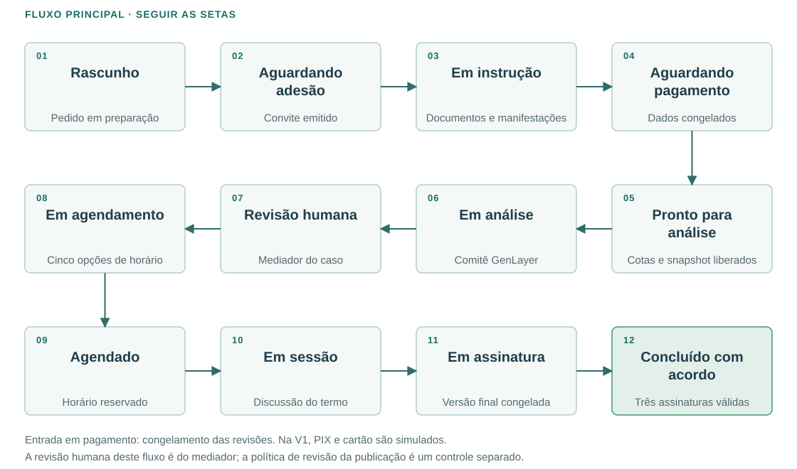

O diagrama segue as setas em três linhas: da esquerda para a direita, depois em sentido inverso e, por fim, da esquerda para a direita. A tabela abaixo detalha a condição exigida para cada transição. Na V1, o pagamento é simulado. “Revisão humana” é a revisão do mediador após o resultado do comitê; a opção administrativa de revisão da publicação pública pertence ao processamento documental e não remove esse estado.

| Estado principal | Condição para avançar | Próximo estado |
| --- | --- | --- |
| Rascunho | Pedido válido e convite emitido | Aguardando adesão |
| Aguardando adesão | Aceite autenticado e atual | Em instrução |
| Em instrução | KYC das pessoas atuantes, representação quando aplicável, documentos e revisões válidos; ação do requerido | Aguardando pagamento |
| Aguardando pagamento | Cotas positivas liquidadas e snapshot liberado | Pronto para análise |
| Pronto para análise | Execução registrada pelo worker | Em análise |
| Em análise | Resultado validado e finalizado | Revisão humana |
| Revisão humana | Mediador salva termo e propõe cinco horários | Em agendamento |
| Em agendamento | Interseção confirmada e horário reservado | Agendado |
| Agendado | Sessão iniciada pelo mediador | Em sessão |
| Em sessão | Versão final concordada | Em assinatura |
| Em assinatura | Três assinaturas válidas da mesma versão | Concluído com acordo |

### 11B Estados alternativos e retomada

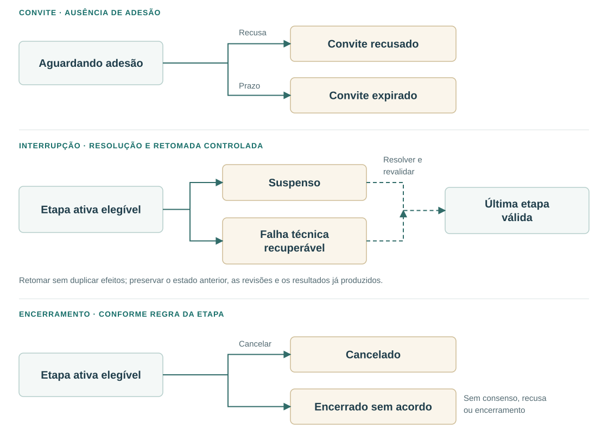

Estados alternativos: convite recusado, convite expirado, cancelado, suspenso, falha técnica recuperável e encerrado sem acordo. Toda transição tem autor, data, motivo e condições verificadas no servidor. Termo final de encerramento deve existir também quando não houver acordo, conforme modelo a aprovar. “Etapa ativa elegível” representa uma etapa na qual a regra correspondente permite a interrupção ou o encerramento; não autoriza cancelar ou reabrir qualquer estado indiscriminadamente. As setas tracejadas indicam retomada após resolução e revalidação da última etapa válida, com idempotência e sem apagar o histórico. O diagrama não define reabertura automática de convites recusados/expirados ou de processos encerrados.

RT-11. Usar transações PostgreSQL e controle de concorrência por revisão. Congelamento, cálculo de cotas, emissão do evento e registro do snapshot devem formar uma operação consistente. Integrações externas não permanecem dentro de transações longas; usar estados intermediários, outbox e reconciliação.

RT-12. Comandos relevantes recebem chave de idempotência: convite, cobrança, congelamento, análise, remarcação e assinatura. Repetir a mesma chave e conteúdo retorna a operação existente; reutilizar a chave com conteúdo diferente resulta em conflito. Webhooks têm restrição única por provedor e ID do evento.

## 12 Integração com o comitê GenLayer

RF-27. Um worker consome processos prontos e submete transação ao Intelligent Contract. Persistir rede, endereço do contrato, versão e hash do código, UUID e hash do snapshot, ID da operação, remetente, hash da transação e tentativas. A carteira é da plataforma, com segredo protegido; usuários não precisam de carteira blockchain para mediar.

A interface proposta é analyze_case(snapshot_uuid). O contrato deriva a URL de um domínio fixo autorizado, carrega o snapshot imutável e valida seu esquema. É recomendável também fixar ou verificar o hash de entrada; isso pode exigir registro anterior ou extensão da interface. Não aceitar URLs arbitrárias fornecidas pelo usuário.

RF-28. Acompanhar submissão, execução, eventual decisão provisória e finalização conforme a rede contratada. Não tratar recibo inicial ou resultado provisório como consenso final. Salvar o retorno bruto e a representação normalizada; verificar UUID, esquema e versão esperados antes de liberar o mediador. A infraestrutura GenLayer possui processo próprio de consenso e finalização. [F7]

RT-13. Se houver timeout após envio, procurar a transação existente antes de reenviar. Persistir a transação assinada ou informações suficientes para recuperar seu hash antes da transmissão. Serializar nonces por carteira. Falta de saldo, RPC indisponível, resultado inválido ou ausência de consenso suspendem a operação com motivo e limite de tentativas. Falhas técnicas não podem produzir status de parecer aprovado.

O código ic_v30.py examinado em 29/09/2026 valida IDs numéricos de quatro dígitos, monta URL de dataset e armazena case_id, painel e termo_opcao em um único conjunto de campos. Portanto, não suporta diretamente UUIDv7 e histórico concorrente de várias mediações. A interface pública de análise examinada também precisa de política de autorização e proteção contra reexecução para uso em produção.

Proposta de adaptação: contrato com registros por snapshot UUID, controle do chamador, entrada imutável, resultado recuperável por UUID e execução idempotente. Alternativa a medir: uma instância por processo. Escolher após avaliar armazenamento, taxas e limitações da rede; a instância experimental não deve ser utilizada como armazenamento concorrente de múltiplos casos sem a adaptação correspondente. O adaptador Python ficará isolado das dependências da API web.

RF-29. OpenRouter no backend e consenso on-chain são integrações diferentes. O primeiro prepara documentos e executa tarefas auxiliares. O segundo decide a validade do parecer sob o protocolo GenLayer. O runner local de múltiplas LLMs não será apresentado como consenso on-chain. A configuração de provedores OpenRouter não controla automaticamente os modelos dos validadores.

CA-02. Validar em ambiente de teste dois processos concorrentes, recuperação após reinício do worker, indisponibilidade do endpoint público, resultado provisório, finalização, ausência de consenso e tentativa duplicada. Cada resultado deve permanecer associado ao snapshot correto. A versão do IC promovida será escolhida pelo processo de validação do projeto, com base em evidências de validação, independentemente da numeração da versão.

## 13 Administração e mediadores

RF-30. O primeiro administrador é criado por procedimento de bootstrap de uso único, vinculado a identidade previamente autorizada. Deve completar o mesmo KYC e autenticação adicional antes de acessar operações administrativas. Desabilitar o bootstrap após uso. Administradores ativos podem convidar outros administradores; o convite não contorna o KYC.

RF-31. Mediadores somente entram por convite administrativo e completam cadastro, KYC e verificação de capacitação pela operação. Registrar situação ativa/inativa, disponibilidade, conflitos de interesse, atribuições e aceite das regras. KYC verifica identidade; não comprova qualificação profissional.

RF-32. Na criação formal do caso, sortear um mediador elegível, registrando candidatos elegíveis, resultado, data e regra utilizada. A atribuição inicialmente fica oculta às partes. Caso não haja mediador elegível, manter em fila de atribuição e alertar a operação; preservar o caso e sua posição no fluxo operacional. Limites de carga podem filtrar os elegíveis antes do sorteio, como política proposta.

RF-33. Após consenso final e liberação para revisão, o mediador é notificado e acessa documentos originais de identificação, provas, cartas, valor em disputa e parecer de IA do caso atribuído. Impedimento, suspeição ou indisponibilidade levam a reassociação auditada. Proposta: revelar o mediador às partes antes do agendamento, com possibilidade de objeção; a seleção interna não substitui sua aceitação pelas partes. [F1] Em casos empresariais, o mediador também acessa o cadastro privado da empresa, os dados de seu representante e os registros de representação autorizados para aquele caso.

RF-34. O painel administrativo gerencia convites, habilitação de mediadores, exceções KYC, filas com falha, pagamentos em reconciliação, casos suspensos e políticas versionadas, incluindo ligar ou desligar a revisão humana de publicações públicas conforme RF-58. Ações críticas exigem motivo e reautenticação. Não permitir editar diretamente snapshots, transações pagas, pareceres originais ou acordos assinados, mesmo pelo administrador.

## 14 Revisão humana e versões do termo

RF-35. O resultado estruturado do comitê será preservado integralmente. A primeira minuta de termo derivada dele recebe v1 e referência ao resultado. Se o IC fornecer alternativas ou Termos de Opção, mostrá-los como propostas de negociação; a plataforma não deve selecionar um acordo em nome das partes.

RF-36. O mediador edita livremente a minuta em editor com formatação. Cada clique em Salvar cria nova versão imutável com autor, horário, motivo opcional e referência à versão anterior. Autosave pode preservar um rascunho de recuperação, mas não substitui as versões explícitas. Usar controle de concorrência para que duas abas não sobrescrevam silenciosamente o trabalho.

RF-37. O mediador pode aprovar para discussão, rejeitar o parecer com justificativa ou solicitar complementação. Complementação não desbloqueia o snapshot original: abre uma rodada adicional, com novos anexos, ciência das partes, nova versão de entrada e eventual análise separada. Custos e necessidade de novo aceite dessa rodada são decisões pendentes.

RF-38. “Notificar as partes para agendamento” exige termo salvo e cinco horários válidos. A notificação diz que a minuta está pronta para discussão, sem afirmar que já existe acordo. Registrar qual versão foi apresentada e disponibilizada em cada etapa.

O gerador termo_mediador.py poderá apoiar a apresentação das opções; termo_acordo.py poderá apoiar a minuta final. Sua adaptação deve preservar valores definidos pelas partes, não cumulatividade, pendências e proveniência, com revisão das regras já existentes em docs/TERMO_ACORDO_FORMAL.md.

## 15 Agendamento, remarcação e sessão

RF-39. O mediador propõe exatamente cinco opções futuras, distintas e reserváveis em sua agenda. Guardar início, término, fuso IANA e rodada. Persistir instantes em UTC e mostrar America/Sao_Paulo por padrão, com fuso explícito para participantes em outras localidades. Proposta inicial: sessões de sessenta minutos, duração ajustável pela operação.

RF-40. Para responder à rodada de agendamento, cada parte deve escolher pelo menos três das mesmas cinco opções — podendo marcar três, quatro ou todas as cinco — ou solicitar remarcação com multa conforme RF-42. A interface mostra a quantidade selecionada e permite confirmar a seleção somente com três a cinco opções distintas da rodada vigente. A API rejeita confirmação com menos de três opções, opções repetidas, inexistentes ou pertencentes a outra rodada, bem como rodada expirada. Como cada conjunto contém pelo menos três elementos entre cinco, há ao menos uma interseção quando ambas as partes confirmam seleções válidas da mesma rodada. A garantia não se aplica enquanto houver remarcação pendente ou ausência de resposta; esses eventos não equivalem a seleção nem geram aceite automático.

RF-41. Uma única interseção confirma o horário se a reserva ainda estiver válida. Com mais de uma, o mediador escolhe uma delas. Antes de confirmar, verificar conflitos de agenda e reservar atomicamente; liberar as demais opções. Enviar confirmação, instruções e lembretes. Prazos de resposta e de validade das opções são parâmetros pendentes.

RF-42. Como alternativa à seleção de pelo menos três horários, a parte pode solicitar remarcação com justificativa e pagamento de multa. Essa opção atende inclusive quem dispõe de somente um ou dois dos cinco horários. Na V1, a multa é simulada. Mantém-se o valor inicial proposto de R$99 e a progressão R$99 × 2^(n−1), em que n é a remarcação paga solicitada por aquela parte naquele caso: R$99, R$198, R$396 e assim por diante. Mostrar a multa aplicável antes de confirmar a solicitação. O contador é individual; solicitação abandonada ou pagamento falho não o incrementa. A nova rodada depende da confirmação do pagamento, conforme RF-43.

RF-43. Após confirmação do pagamento, o mediador abre nova rodada com cinco opções, considerando a justificativa. Invalidar escolhas anteriores e pedir nova seleção a ambos. Para solicitações simultâneas, vincular à mesma rodada de substituição e bloquear cobrança duplicada para a mesma necessidade; regra de quem paga quando ambos pedem deve ser definida antes da produção.

Proposta: remarcação por erro da plataforma ou indisponibilidade do mediador é gratuita e não incrementa o contador. Teto, isenções, contestação, ausência na sessão e desistência precisam de política aprovada. A multa de remarcação não elimina a possibilidade de encerrar voluntariamente a mediação.

RF-44. Após a confirmação do dia e horário da sessão, o mediador responsável pode cadastrar na Mediare o link da videoconferência criada no serviço de sua preferência, como Zoom, Google Meet, Microsoft Teams ou outro equivalente. O link pode ser inserido posteriormente ao agendamento, inclusive no dia da sessão, e deve estar disponível até seu início. Não exigir o link para confirmar o horário; enquanto ausente, mostrar às partes “Link da videoconferência a ser informado pelo mediador”. Na V1, a plataforma armazena e disponibiliza a URL externa; não cria salas automaticamente nem exige integração por API, contas conectadas ou vídeo incorporado.

O cadastro da sala permite informar serviço, URL HTTPS e instruções de acesso opcionais. Somente o mediador atualmente atribuído ao caso pode inserir ou alterar o link; o backend registra autor, data, versão e sessão vinculada. Validar o formato e o esquema da URL sem buscar automaticamente seu conteúdo. Publicar o botão “Entrar na videoconferência” na área autenticada do caso, abrindo o serviço externo. O link fica restrito às partes, aos representantes autorizados quando houver empresa e ao mediador, sem inclusão no JSON público ou no resultado on-chain.

Ao cadastrar ou alterar o link, notificar ambas as partes pelos canais previstos, direcionando-as à área autenticada da sessão para consultar o endereço vigente e as instruções. A confirmação inicial do horário pode ser enviada antes da inclusão do link. Alterar apenas a URL não modifica o agendamento nem gera multa de remarcação. Após uma mudança de dia ou horário, exigir que o mediador confirme a validade do link para a nova sessão ou informe outro; não reutilizar silenciosamente dados da rodada anterior. Preservar o histórico, sem apresentar links substituídos como vigentes.

O mediador administra a sala e os controles de entrada no serviço escolhido, acompanha o acesso das partes e utiliza os recursos externos para discutir a minuta. A Mediare continua responsável pelo termo, versões, agendamento e assinatura. Não gravar a sessão por padrão. O início e o encerramento da sessão são registrados pelo mediador no sistema; abrir o link não comprova presença nem inicia automaticamente o estado “Em sessão”.

## 16 Acordo, assinatura e encerramento

RF-45. Durante a sessão, o mediador apresenta e ajusta o termo com as partes. Antes de solicitar assinaturas, todas as obrigações devem estar fechadas: partes, objeto, valores ou fórmulas plenamente determinadas, prazos, forma de cumprimento e escopo da quitação. O aceite da sugestão de IA não substitui concordância sobre a redação final.

RF-46. Congelar a versão final e gerar PDF para assinatura. Criar envelope de assinatura com requerente, requerido e mediador, vinculando versão, hash do conteúdo e identidades verificadas. Cada signatário acessa sua conta, realiza autenticação adicional quando exigida e manifesta intenção de assinar a versão exibida. Imagem de assinatura colada no PDF não atende, por si, a esse requisito. Quando requerente ou requerido for empresa, o signatário humano correspondente é seu representante habilitado, com a empresa indicada como parte representada. No fluxo padrão permanecem três assinaturas: uma por cada parte, prestada pessoalmente ou por representante, e a do mediador. Eventual exigência de representação conjunta deve ser tratada na definição de D-18, antes de habilitar esse caso.

RF-47. Usar fornecedor de assinatura eletrônica/digital com trilha de evidências, integridade verificável, API, webhooks e exportação do documento e comprovante. Escolher se o produto exige certificado ICP-Brasil ou outro mecanismo adequado ao ato. Modalidade, fornecedor e requisitos de testemunhas/representação devem ser validados para os casos atendidos; não prometer validade automática de qualquer clique. A integração escolhida deve permitir envio e recuperação do documento pelo backend, sem depender de acesso do fornecedor a um bucket ou URL pré-assinada do S3.

RF-48. As três assinaturas precisam corresponder à mesma revisão do conteúdo. Se o texto mudar durante a coleta, cancelar o envelope, preservar seu histórico e solicitar novas assinaturas. PDFs podem receber revisões incrementais do provedor ao incorporar assinaturas; manter o hash da minuta e o hash final, além da evidência de integridade de cada etapa. Se houver substituição de representante antes da conclusão, cancelar o envelope pendente e gerar outro com o signatário atualizado, preservando os registros anteriores e solicitando novas assinaturas. A assinatura concluída de representante depois substituído permanece no histórico, sem transferência da assinatura ao novo usuário.

RF-49. Após confirmação verificada de todas as assinaturas, arquivar PDF final e evidências em S3 privado, registrar conclusão e notificar os participantes. Permitir download autenticado pelas partes e mediador conforme retenção. O acordo final contém dados pessoais e não integra o endpoint público nem o blockchain. Para empresa, o download é realizado por representante com vínculo e permissão atuais para o caso; a simples titularidade de um cadastro com o mesmo CNPJ não concede acesso.

RF-50. Se não houver consenso, assinatura for recusada ou o procedimento for encerrado, registrar termo de encerramento sem acordo e motivo adequado. O fundamento do termo final com acordo inclui o art. 20 da Lei de Mediação; requisitos de exigibilidade e assinatura devem ser conferidos no modelo aplicável. [F1, F8]

## 17 Arquitetura e evolução em três fases

### 17A Fases de infraestrutura

A sequência aprovada é local → AWS → Kubernetes. Essas fases descrevem onde executar a plataforma e não alteram o escopo funcional da V1, o MER ou o uso inicial de pagamentos simulados. O termo piloto, quando ligado às regras de produto, mantém revisão humana de publicação ligada por padrão e ausência de cobrança real; ele não exige começar em nuvem.

| Fase | Ambiente e execução | Dependências | Condição para avançar |
| --- | --- | --- | --- |
| 1 — Local, prioridade atual | Docker Compose na máquina do desenvolvedor; frontend, API e workers em containers | PostgreSQL em container, LocalStack (S3/DynamoDB/SQS) e Mailpit; OpenRouter, Google e GenLayer externos | Fluxo com dados sintéticos, integrações reais de teste e retomada reproduzíveis sem provisionar AWS |
| 2 — AWS, implantação posterior | ECS Fargate para aplicação e workers; infraestrutura via Terraform | RDS PostgreSQL, DynamoDB, S3, SQS, IAM/KMS e serviços AWS de entrada/operação | Homologação dos serviços reais, segurança de rede, integrações, backup e recuperação |
| 3 — Kubernetes, evolução futura | Migração do runtime para Kubernetes; EKS proposto | Mesmos serviços de dados e contratos da fase 2; Helm e KEDA somente nesta fase | Justificativa operacional, homologação, observabilidade e plano de migração/retorno |

AWS permanece o destino de nuvem planejado desde o desenho dos contratos, sem ser uma dependência de execução ou uma entrega de provisionamento da fase 1. A adoção da fase 2 não ativa cobrança real automaticamente. Kubernetes não será requisito de desenvolvimento local nem da primeira implantação AWS.

### 17B Fase 1 — Docker Compose e LocalStack

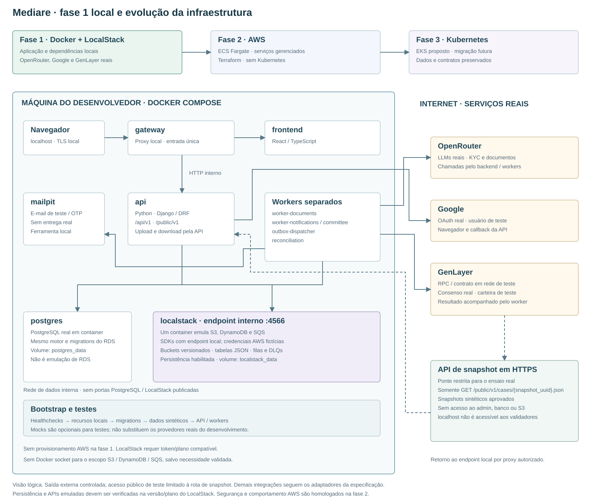

A proposta local executa as unidades da aplicação e suas dependências por Docker Compose. Não exige instalar Python, Node.js, PostgreSQL ou serviços AWS diretamente no host; ferramentas de edição e o runtime Docker continuam no computador do desenvolvedor. Versões de imagens e dependências serão fixadas na implementação. Internet será necessária para baixar imagens, ativar LocalStack e utilizar OpenRouter, Google e GenLayer. Infraestrutura local não significa operação integralmente offline. [F23]

| Serviço no Compose | Implementação proposta | Responsabilidade e destino na fase 2 |
| --- | --- | --- |
| gateway | Proxy reverso em container, com TLS local | Entrada em loopback, roteamento do site, /api e /public/v1; substituído pela entrada AWS |
| frontend | React/TypeScript em container; modo de desenvolvimento e build de entrega | Mesmas telas e contrato HTTP; imagem de distribuição implantável no ECS |
| api | Imagem Python da Mediare com comando próprio | Django/DRF e domínio modular; mesma base de código no ECS |
| worker-documents, worker-notifications, worker-committee | Containers separados da imagem Python, com comandos próprios | Trabalho assíncrono; recursos e concorrência configuráveis |
| outbox-dispatcher, reconciliation | Containers separados da imagem Python | Publicação idempotente e reparação de inconsistências |
| postgres | PostgreSQL em container, com volume persistente | Mesmo motor relacional e migrations do futuro RDS |
| localstack | Imagem localstack/localstack com versão/digest fixados; serviços s3, dynamodb e sqs | Um container emula buckets/objetos, tabelas JSON, filas e DLQs; substituído pelos três serviços gerenciados AWS |
| mailpit | Mailpit em container | Captura e-mail/OTP em caixa local, sem entrega real; substituído pelo provedor de e-mail |
| provider-stubs, perfil tests | Serviço opcional de testes da Mediare, com respostas e callbacks determinísticos | Testes isolados e injeção de falhas; não substitui OpenRouter, Google e consenso GenLayer no fluxo de desenvolvimento integrado |
| bootstrap, migrate, seed, tests | Comandos ou serviços de execução única em containers | Inicialização idempotente, migrations, dados sintéticos e validações; não são serviços permanentes |

LocalStack emula as APIs de S3, DynamoDB e SQS dentro do Docker; API e workers usam os SDKs AWS com endpoint local explícito. PostgreSQL executa seu próprio motor em container; não é necessário emular o RDS nesta fase. Mailpit continua como ferramenta local para e-mail. A emulação não comprova paridade integral de IAM, políticas VPC, SSE-KMS, quotas, escala ou disponibilidade. [F24, F25, F27]

A distribuição atual do LocalStack usa conta e LOCALSTACK_AUTH_TOKEN. Selecionar plano/licença compatível com o projeto e com persistência de estado; não presumir que a edição gratuita cubra uso comercial ou todos os requisitos. Guardar token fora do Git e validar a modalidade de CI aplicável. Isso não exige conta AWS nem cria recursos AWS reais. [F26]

RT-48. Fornecer uma composição local completa e reproduzível, sem exigir recursos AWS reais; credenciais LocalStack e dos provedores reais permanecem necessárias no modo integrado. Manter imagens OCI e os mesmos comandos da API/workers entre as fases; diferenças de endpoints, credenciais e drivers ficam na configuração e nos adaptadores. Bibliotecas de domínio não contêm ramificações específicas de Compose, ECS ou EKS. Não substituir regras de negócio por resultados fixos: simuladores ficam exclusivamente nas fronteiras externas.

### 17C Fase 2 — infraestrutura AWS

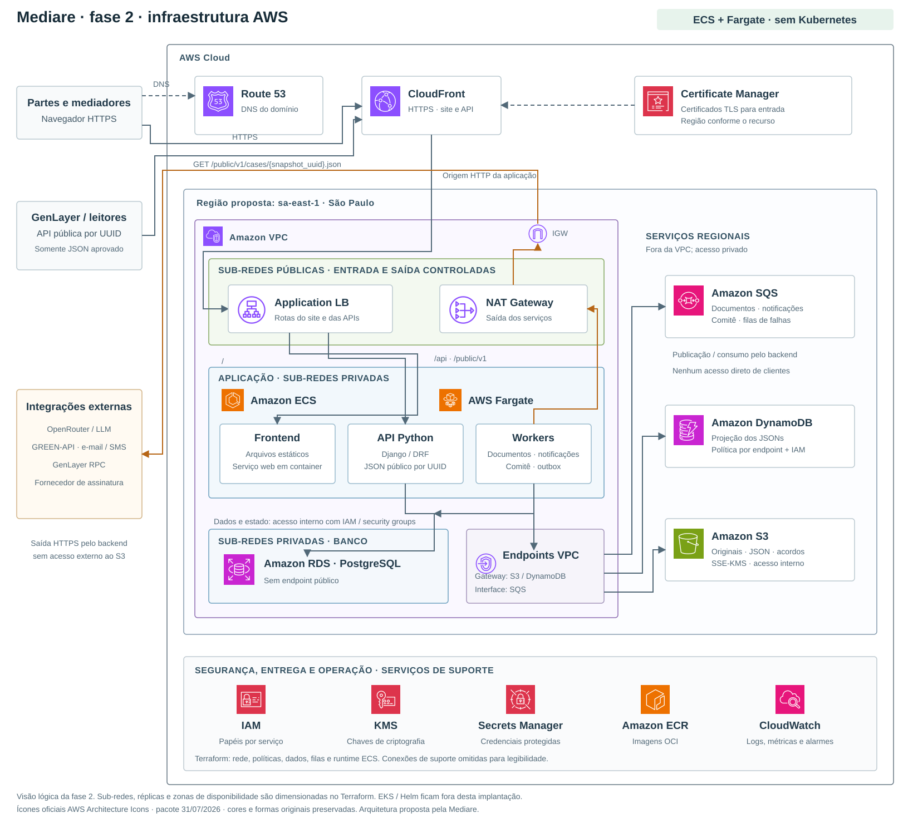

O diagrama utiliza os ícones coloridos originais do pacote oficial AWS Architecture Icons de 31/07/2026, incorporados ao documento para leitura offline. As caixas distinguem serviços globais de entrada, região, VPC, sub-redes e serviços gerenciados. S3, DynamoDB e SQS ficam fora da VPC como serviços regionais, acessados internamente por endpoints e políticas; somente PostgreSQL está nas sub-redes privadas de banco. A faixa de suporte é uma referência lógica: IAM tem escopo global, e os demais serviços usam a região aplicável. Não representa um segundo caminho de entrada para clientes. [F22]

Clientes acessam CloudFront e o Application Load Balancer, que encaminha tráfego aos serviços web e API no ECS Fargate. Route 53 resolve DNS; não é um proxy no caminho dos dados. ACM fornece os certificados TLS conforme o recurso. O ALB deve aceitar o tráfego da origem autorizada e encaminhar somente às tarefas esperadas. O frontend é servido por container; o S3 não é origem pública do site. A API e os workers acessam os dados privados; integrações externas usam saída controlada por NAT e Internet Gateway. A resposta HTTP retorna pelo mesmo caminho de entrada, embora as setas mostrem apenas o sentido da solicitação.

O desenho é uma visão lógica, não um dimensionamento de réplicas ou zonas de disponibilidade. O Terraform define a distribuição em sub-redes/AZs exigida pelos serviços e a capacidade do ambiente AWS. Endpoints gateway atendem S3 e DynamoDB; o endpoint de interface para SQS é a proposta representada. Serviços de suporte incluem IAM, KMS, Secrets Manager, ECR e CloudWatch. Não há componentes Kubernetes neste diagrama nem na fase 2.

### 17D Componentes comuns e contratos de migração

RT-14. Adotar domínio modular com API e workers implantáveis e escaláveis separadamente. Cada módulo expõe serviços de aplicação e interfaces de repositório/adaptador; implementações locais via LocalStack e implementações AWS respeitam o mesmo contrato. API e workers podem compartilhar uma biblioteca de domínio versionada. Os módulos não dependem de memória compartilhada ou disco persistente dos containers de aplicação; a persistência local pertence aos volumes dos serviços de dados. Processos comunicam-se por APIs e mensagens. Kubernetes não exige decompor todas as entidades em microsserviços.

| Contrato | Fase 1 local | Fase 2 AWS | Fase 3 Kubernetes |
| --- | --- | --- | --- |
| HTTP e frontend | gateway e serviço web local; mesmas rotas e autenticação | CloudFront/ALB e frontend em ECS | Entrada homologada para o cluster, preservando as rotas |
| PostgreSQL | postgres, mesmo schema/migrations do MER | RDS PostgreSQL privado | RDS preservado, fora do cluster |
| Artefatos JSON | DynamoDB no LocalStack e mesmos PK/SK/schema_version | DynamoDB privado por endpoint/política | Mesmo DynamoDB, fora do cluster |
| Objetos | S3 no LocalStack; endpoint local e versionamento testado | S3 privado com SSE-KMS e versões próprias | Mesmo S3, fora do cluster |
| Mensagens | SQS no LocalStack; cliente SQS, DLQs e outbox | SQS e DLQs reais | SQS; consumidores no cluster |
| Processamento e domínio | API/workers com configuração local | Serviços ECS Fargate e task roles | Deployments e identidades EKS homologadas |
| IA auxiliar e comitê | OpenRouter e GenLayer reais; mocks apenas no perfil tests | OpenRouter e GenLayer conforme homologação | Mesmos contratos externos |
| Google / OAuth | Login Google real, clientes e callbacks de desenvolvimento | Login Google com configuração do ambiente AWS | Mesma integração externa |
| Comunicação e assinatura | Mailpit e adaptadores de teste até homologar os demais fornecedores | Fornecedores reais escolhidos | Mesmas integrações externas |
| Pagamento | Simulador PIX/cartão na V1 | Simulador continua até a etapa funcional de cobrança real | Modalidade funcional aprovada, independente do runtime |
| Infraestrutura | Compose, arquivos locais de configuração e volumes | Terraform modular por ambiente | Terraform EKS e Helm; dados persistentes preservados |

A escolha de Django considera a quantidade de cadastros, permissões e operações administrativas. Django REST Framework atende a exposição de APIs. FastAPI permanece uma alternativa se a equipe o dominar; não há benefício demonstrado em usar os dois frameworks simultaneamente. [F9]

Fluxo comum de dados: navegador → gateway/API → PostgreSQL; upload autenticado → API → armazenamento de objetos; outbox → fila → worker → objeto canônico e projeção JSON; liberação transacional → API de JSON por UUID → consumidor autorizado pelo escopo público. Cada fase troca a implementação da infraestrutura sem alterar esse fluxo, a validação de publicação ou a autorização de acesso aos originais. Videoconferência continua sendo um link externo cadastrado pelo mediador, sem API de vídeo obrigatória.

Módulos sugeridos: accounts, identity, cases, documents, billing, notifications, committee, mediation, scheduling, agreements e audit. IDs, enums, schemas e código seguem a convenção de inglês de RT-46.

## 18 Execução local, implantação AWS e Kubernetes futuro

RT-15. Separar as três fases e os ambientes: local na fase 1; homologação e produção AWS na fase 2; Kubernetes na fase 3. Local não requer conta AWS. Em nuvem, preferir contas distintas para homologação e produção. Bancos, armazenamento, filas, chaves, carteiras e credenciais são isolados. Usar dados sintéticos localmente; não copiar KYC real para desenvolvimento. A homologação AWS verifica comportamentos que substitutos locais não comprovam.

Decisão de implantação: fase 1 com Docker Compose e LocalStack; fase 2 com ECS Fargate; fase 3 com Kubernetes/EKS proposto. Não há Kubernetes, EKS, Helm, KEDA nem testes de cluster como condição de conclusão das fases 1 ou 2. Na fase 3, RDS, DynamoDB, S3 e SQS permanecem gerenciados fora do cluster. Migrar ECS para EKS não recria esses recursos nem muda a identidade dos casos. A passagem do ambiente local para AWS exige inicialização e validação dos serviços reais, não apenas troca de imagens.

Para a fase 2, a região primária proposta é sa-east-1, São Paulo, sujeita à disponibilidade dos serviços e ao orçamento. Essa escolha não garante residência brasileira de OpenRouter, Google, WhatsApp, assinatura ou GenLayer; as transferências externas precisam ser tratadas separadamente. A aplicação começa em uma região; replicação multirregional exige projeto próprio.

### 18A Unidades de execução

RT-24. Definir comandos de entrada independentes para api, worker-documents, worker-notifications, worker-committee, outbox-dispatcher e reconciliation. API não executa OCR nem espera inferência ou consenso dentro de uma requisição. A mesma imagem pode atender comandos diferentes, mas cada unidade terá recursos e concorrência próprios; identidades IAM distintas aplicam-se a partir da fase 2. Na V1, extração textual simples permanece no worker e a leitura complexa usa a rota OpenRouter autorizada. Se OCR local for incorporado depois, suas dependências pesadas podem ter imagem separada. A distribuição do frontend pode usar um serviço separado de arquivos estáticos em container, atrás da entrada HTTPS, sem abrir acesso externo ao S3. A API de upload será dimensionada para transferência de arquivos; processamento documental continua nos workers.

RT-25. Containers OCI serão reproduzíveis, executados como usuário não privilegiado, com configuração externa, limites de CPU/memória e logs estruturados em stdout/stderr. Arquivos temporários são descartáveis, limitados e limpos. Sessões, progresso de tarefas, locks e resultados ficam em serviços externos. Nenhuma requisição exige afinidade com um container ou réplica específica.

RT-26. Tratar SIGTERM e encerramento gradual: a API deixa de aceitar tráfego antes de sair; workers param de buscar mensagens e só confirmam as concluídas. Tarefa interrompida deve voltar à fila de modo seguro. Configurar tempo de invisibilidade, renovação e período de encerramento conforme a carga, sem depender de terminar qualquer OCR ou chamada externa antes do encerramento do container. Aplicar esses controles aos containers Compose na fase 1, às tasks ECS Fargate na fase 2 e aos pods somente na fase 3. [F14]

RT-27. Requisito exclusivo da fase 3, fora das entregas e critérios de conclusão das fases 1 e 2: prever Helm chart com Deployments da API, workers e dispatcher; Services; configuração de entrada HTTPS; ServiceAccounts; ConfigMaps; referências a segredos; requests/limits; probes; e Job exclusivo de migração. Readiness controla admissão de tráfego; liveness detecta travamento local e não deve provocar reinícios em massa em razão exclusiva da indisponibilidade de um fornecedor externo. Migrações não serão executadas por cada réplica ao iniciar.

RT-28. Na fase 1, usar credenciais locais de teste e endpoints explícitos, sem chaves AWS reais. Na fase 2 ECS Fargate, cada serviço usa task roles IAM próprias. Somente em uma futura migração para EKS, cada workload usará identidade IAM por ServiceAccount, com EKS Pod Identity quando compatível ou IRSA quando necessário. Não distribuir chaves AWS estáticas. Os requisitos de RBAC, acesso ao cluster, políticas de rede Kubernetes e privilégios de pods aplicam-se apenas à fase 3 EKS, não às fases 1 e 2. [F13]

RT-29. Na fase 1, limitar recursos e escalar workers manualmente no Compose para testar concorrência. Na fase 2, usar mecanismos de escalabilidade do ECS para a API por carga e para workers por backlog/idade das mensagens, com métricas CloudWatch adequadas ao serviço. KEDA para SQS será avaliado somente se houver migração futura para EKS. Definir máximo de réplicas, conexões ao banco, concorrência de LLM e orçamento. O aumento de workers deve respeitar os limites dos fornecedores e preservar a prevenção de envios duplicados. O worker GenLayer coordena nonce por carteira de forma externa e transacional. [F13]

### 18B Filas de mensagens

RT-17. Usar SQS emulado pelo LocalStack na fase 1 e Amazon SQS na fase 2, com fila de falhas própria por classe de trabalho: documents, notifications e committee. Separar códigos de autenticação das notificações comuns para evitar atraso atrás de grandes lotes. O dispatcher lê eventos da outbox PostgreSQL e publica nas filas; o consumidor reconhece a mensagem somente após registrar o efeito durável. Duplicatas são esperadas e tratadas por chave de idempotência. [F6]

Proposta de envelope: event_id, event_type, schema_version, job_id, case_id, artifact_id, artifact_version, correlation_id e occurred_at. Mensagens carregam referências, nunca documentos completos, números de identificação, senhas, códigos OTP em claro ou URLs assinadas. Segredos temporários necessários ao envio serão obtidos pelo worker em armazenamento controlado e eliminados após uso.

RT-30. Usar SQS Standard como padrão; adotar FIFO apenas se um fluxo tiver necessidade demonstrada de ordenação por grupo. Mesmo com FIFO, efeitos externos continuam idempotentes. O banco valida revisão/estado para eventos atrasados. Configurar long polling, invisibilidade, renovação, tentativas limitadas, fila de falhas, alarmes e reprocessamento auditado. Reprocessar não pode reativar um arquivo excluído ou um caso cancelado.

### 18C Rede, segurança e hospedagem

RT-16. PostgreSQL, DynamoDB e armazenamento S3 não permitem acesso externo direto aos dados. Na fase 1, dependências ficam na rede interna Compose, sem publicar suas portas no host ou na LAN; clientes acessam a API local. Na fase 2, o RDS PostgreSQL terá acesso público desabilitado, sub-redes privadas e security groups limitados aos serviços internos autorizados. DynamoDB e S3 serão acessados por endpoints VPC e papéis IAM próprios da plataforma; suas políticas de recurso devem negar operações de dados fora dos endpoints autorizados, inclusive quando uma credencial de aplicação válida for usada pela internet. Os serviços gerenciados não são bancos instalados dentro dos pods ou das sub-redes: a restrição resulta da combinação de rota privada, políticas de endpoint, IAM e políticas de recurso. Criar apenas um endpoint VPC não elimina outros caminhos de acesso; o bloqueio deve estar nas políticas e ser verificado. [F20, F21]

Somente os pontos de entrada HTTPS da aplicação e das APIs serão expostos. Para consulta pública de processos, disponibilizar exclusivamente GET /public/v1/cases/{snapshot_uuid}.json, conforme RF-16. A API devolve o JSON saneado aprovado; nenhuma rota expõe dados brutos de tabelas ou acesso genérico ao S3. Endpoints de upload, documentos originais e acordos permanecem autenticados. GenLayer e demais consumidores públicos chamam a API, nunca o armazenamento. O acesso autorizado a provedores externos de IA ou assinatura ocorre pelo backend, que transmite o conteúdo necessário conforme as políticas próprias, sem conceder acesso ao S3. Na fase 1, a entrada ordinária é loopback; a exceção de teste GenLayer é exclusivamente a ponte HTTPS restrita de RT-54.

Serviços, futuras instâncias/pods, jobs operacionais e executores de implantação usam redes e identidades controladas. Manutenção de políticas deve preservar a capacidade administrativa de recuperação sem criar exceção de leitura ou gravação de dados pela internet. Rotinas internas de backup e restauração recebem permissões específicas e são validadas com as restrições em vigor. Planejar saída para OpenRouter, GREEN-API e RPC por rota controlada, contabilizando NAT e transferência; não abrir bancos ou buckets para viabilizar essas integrações.

Na fase 1, gateway local e frontend em container preservam as rotas da aplicação. Na fase 2, o destino do frontend será AWS: arquivos estáticos empacotados na imagem de um serviço web, com CloudFront apontando para a origem HTTP controlada da aplicação, domínio próprio e certificados ACM. Não usar bucket S3 como origem diretamente acessada pela distribuição, nem habilitar website público em S3. Essa proposta mantém toda a comunicação com S3 restrita aos serviços internos. A landing page na Netlify permanece até a migração. Frontend e API podem compartilhar a origem com comportamentos separados de roteamento e cache; encaminhar /api e /public/v1 ao backend. Cache de arquivos estáticos não se aplica a documentos privados nem ao endpoint público de snapshots no piloto. Snapshots seguem o controle de publicação e retirada da seção 8.

### 18D Terraform na fase 2

RT-31. Dockerfiles, compose.yaml, configuração de exemplo e bootstrap local serão as entregas de infraestrutura da fase 1. Terraform será uma entrega obrigatória da fase 2 AWS, declarativa e modular, com documentação de operação. Na fase 1, registrar interfaces e requisitos futuros; não exigir terraform apply, estado remoto S3 ou criação de recursos em nuvem para desenvolver. A implementação dos arquivos e o provisionamento são trabalhos posteriores a esta especificação.

| Diretório planejado | Recursos ou responsabilidade | Independência |
| --- | --- | --- |
| compose.yaml e compose.test.yaml | Aplicação, PostgreSQL, LocalStack e override para testes isolados | Fase 1; nenhum recurso AWS provisionado |
| docker/ e scripts/ | Imagens, healthchecks, bootstrap, migrations, seeds e reset explícito | Fase 1; dados sintéticos persistidos em volumes |
| infra/terraform/bootstrap | Bucket de estado, chave KMS e acesso inicial | Estado separado da aplicação |
| infra/terraform/modules/network | VPC, sub-redes, rotas, endpoints privados e security groups | Acesso aos dados restrito à rede interna, independente do runtime |
| infra/terraform/modules/data | RDS privado, DynamoDB/S3 com políticas por endpoint e backup | Sem acesso externo aos dados; preservado na migração ao EKS |
| infra/terraform/modules/messaging | SQS, filas de falhas, políticas e alarmes | Consumidores intercambiáveis |
| infra/terraform/modules/security | IAM, KMS e referências de segredos | Papéis por workload |
| infra/terraform/modules/observability | Logs, métricas, alertas e orçamento | Identificação por ambiente |
| infra/terraform/modules/frontend | CloudFront com origem HTTP da aplicação, DNS e TLS | Sem origem S3 direta; arquivos estáticos no serviço web |
| infra/terraform/modules/registry | Repositórios ECR e política de imagens | Compartilhado pelos runtimes |
| infra/terraform/modules/runtime_ecs | Serviços ECS Fargate, tarefas e balanceador | Runtime AWS da fase 2 |
| infra/terraform/modules/runtime_eks | Planejamento de EKS, capacidade e identidades | Fase 3; fora das fases 1 e 2 |
| infra/terraform/environments | Configuração e estados de dev, staging e prod | Sem credenciais no Git |
| deploy/helm/mediare | Recursos da aplicação Kubernetes | Fase 3; fora das fases 1 e 2 |

RT-32. Na fase 2, manter estados separados para bootstrap, recursos persistentes e runtime, por ambiente/conta. O backend remoto usa S3 cifrado, versionamento, acesso mínimo e bloqueio nativo com use_lockfile. O mecanismo atual de locking em tabela DynamoDB está depreciado no backend S3 do Terraform; a tabela de JSON da aplicação não será utilizada como mecanismo de bloqueio do estado Terraform. Preparar o bucket de estado antes de migrar o estado de bootstrap. [F15] O bucket de estado também obedece ao acesso interno: operações Terraform com acesso ao estado usam executor autorizado com conectividade ao endpoint VPC. O bootstrap deve preparar esse caminho antes de impor a restrição definitiva; não depender de um runner público para acessar o estado protegido.

RT-33. Na fase 2, variáveis incluem região, CIDRs, domínios, ambiente, tags, capacidade, retenção, orçamento, réplicas e modo de pagamento. Fixar versões de providers e módulos. CI usa credenciais temporárias por OIDC, executa fmt, validate e verificações de política, e apresenta plan revisável. Aplicar o plano exato aprovado; mudanças destrutivas em produção exigem revisão explícita. Marcar valores como sensitive não impede que apareçam no estado: restringir o estado e evitar gravar valores de segredos nele. Quando o pipeline precisar acessar estado S3 ou dados internos, o executor roda na rede autorizada. OIDC identifica o executor, mas não substitui o controle de origem de rede. O plano valida endpoints, políticas de recurso e ausência de caminhos alternativos pela internet.

RT-34. Recursos persistentes de produção exigem proteção de exclusão quando disponível, guardas de plano e procedimento de recuperação; prevent_destroy é uma proteção adicional, não substitui backup ou revisão. Não usar force_destroy para buckets de documentos de produção. Terraform cria infraestrutura e configura referências de segredo; migrações de banco e releases de aplicação pertencem ao pipeline de deploy. Não colocar dependência circular entre criação do EKS e instalação de workloads no mesmo passo.

### 18E Implantação, observabilidade e migração

RT-18. Na fase 1, CI executa build das imagens, testes de domínio e integração com as dependências Compose, sem AWS. Na fase 2, acrescentar testes com os serviços gerenciados e publicar imagens imutáveis no ECR; aplicar migrações compatíveis em job único, verificar saúde e permitir rollback da aplicação. Deploy de frontend, API e workers tem versões rastreáveis. Dados e segredos de produção não são disponibilizados para previews.

RT-19. Na fase 1, logs estruturados em stdout/stderr, healthchecks e métricas locais permitem diagnóstico por correlation_id. Na fase 2, CloudWatch e instrumentação de aplicação registram latência, erros, idade da fila, tentativas, falhas de OCR/IA, tokens, custo, conexões PostgreSQL, throttling DynamoDB e tempo de consenso. Usar correlation_id entre API, fila, worker e transação. Alertas têm responsável e procedimento de resposta; logs excluem conteúdo sigiloso.

RT-35. Aplicável somente à fase 3, fora das fases 1 e 2. Antes da migração para EKS, instalar e testar workloads em homologação, validar identidades e acesso aos mesmos contratos de dados, ensaiar interrupções e medir custos. No corte, drenar o runtime anterior e transferir consumidores gradualmente. Evitar dois schedulers ou escritores de carteira sem coordenação; deduplicação continua obrigatória. Alterar roteamento somente após smoke tests e preservar plano de retorno. A restauração deve recuperar referências coerentes entre PostgreSQL, S3 e DynamoDB, não apenas iniciar um novo cluster.

### 18F Operação e validação da fase 1

RT-49. O fluxo local documentado deve incluir build, inicialização, migrations, dados sintéticos, execução, testes, parada e reinício sem perda de dados. Proposta de entrada: docker compose up --build. Um bootstrap idempotente cria buckets/tabelas/filas locais e configura versionamento/DLQs; um job único executa migrations antes de liberar API/workers. Usar healthchecks e condições de prontidão, mais retries na aplicação: iniciar um container não garante que sua dependência esteja pronta. Fixar tags/digests, lockfiles e compatibilidade das imagens com a arquitetura do desenvolvedor. [F23]

RT-50. Persistir PostgreSQL em postgres_data e o estado LocalStack em localstack_data, com montagem em /var/lib/localstack e PERSISTENCE=1 na versão/plano homologados. Verificar restauração efetiva de buckets e versões S3, tabelas DynamoDB e mensagens/DLQs SQS; apenas criar um volume Docker não habilita persistência automaticamente. Um restart não pode apagar filas ou deixar o banco apontando para arquivos inexistentes. Separar dados de teste descartáveis da composição de desenvolvimento. Reset destrutivo deve ser um comando explícito, documentado, sem execução automática no boot. Verificar retorno de um caso em andamento após reiniciar todos os serviços. [F25]

RT-51. A entrada da aplicação fica restrita a 127.0.0.1, com TLS local e certificados de desenvolvimento preparados no bootstrap/documentação; não desativar globalmente cookies seguros, CSRF ou validação de origem para viabilizar testes. Interfaces de Mailpit e simuladores são ferramentas de teste em loopback, nunca parte da API pública ou do deploy de produção. Bancos, S3 local e fila não publicam portas. Acesso técnico ocorre por comandos executados dentro da rede Compose. Rede de dados será interna; saída à internet será controlada para API/workers que usam os provedores reais e para ativação do LocalStack; isso não publica portas de dados no host. Não montar o Docker socket no LocalStack para o escopo S3/DynamoDB/SQS, salvo necessidade técnica comprovada na versão escolhida. [F23]

RT-52. Separar endpoints da infraestrutura local e credenciais das integrações reais. Endpoints de S3/SQS/DynamoDB apontam para http://localstack:4566 dentro da rede Compose; usar path-style no cliente S3 e configurar URLs SQS alcançáveis pelos containers, nunca localhost como endereço de serviço entre containers. Região e conta emuladas são consistentes no bootstrap e nos clientes. Essas configurações são injetadas no SDK; SDK sem endpoint local configurado deve falhar no modo local em vez de tentar AWS. Usar credenciais fictícias, desabilitar busca de credenciais em metadata de instância e não montar credenciais AWS do host. Credenciais de OpenRouter, Google e carteira/RPC GenLayer são separadas das credenciais AWS fictícias usadas no LocalStack. Na nuvem, rejeitar endpoints locais e drivers simulados não autorizados. Segredos de desenvolvimento ficam em arquivos ignorados pelo Git ou Compose secrets; dados pessoais sintéticos podem usar chave local exclusiva para criptografia de campos. Isso não substitui KMS ou comprova SSE-KMS, a validar na fase 2.

| Modo | Objetivo | Comportamento |
| --- | --- | --- |
| local-integrated, desenvolvimento padrão | Infraestrutura local e integrações reais preservadas | Compose, PostgreSQL e LocalStack; OpenRouter, Google e GenLayer reais em contas/redes de teste; internet e credenciais necessárias |
| local-test, opcional | Testes determinísticos e injeção de falhas | Mesma infraestrutura; mocks explícitos nos adaptadores selecionados; nenhum resultado simulado é tratado como análise ou assinatura real |
| aws-staging | Homologar a fase 2 em serviços AWS reais | IAM, endpoints, SSE-KMS, quotas, callbacks, privacidade e recuperação; sem reaproveitar segredos locais |
| aws-production | Operar a versão homologada | Simuladores de identidade, comitê e assinatura proibidos; payment_mode=simulated continua permitido enquanto a V1 não tiver cobrança real |

RT-53. Quando testes isolados usarem simuladores, não contornar o fluxo: OTP, expiração, limites de tentativas, KYC, autorização e revisão humana continuam sendo verificados pelo backend. Callbacks do simulador devem permitir sucesso, recusa, expiração, timeout, duplicação e chegada fora de ordem. PDF de assinatura simulada recebe identificação visível de teste; parecer simulado nunca é apresentado como consenso on-chain. Persistir integration_mode, provider e is_simulated nas evidências relevantes para impedir que dados de teste sejam promovidos como resultados reais. Configurações simuladas falham no startup de produção, exceto o simulador financeiro explicitamente previsto para a V1.

OpenRouter, Google, GREEN-API, provedores de SMS/assinatura e a rede GenLayer não se tornam serviços locais por serem chamados de dentro de um container. OpenRouter, login Google e consenso GenLayer serão mantidos como integrações reais no desenvolvimento da fase 1. Usar credenciais de teste, limites de consumo e configuração de callback Google compatível com a origem local. Os mocks opcionais de testes não alteram essa decisão. Outros fornecedores serão conectados conforme sua homologação funcional. Uma LLM local não compõe a proposta atual; o processamento real permanece no OpenRouter.

RT-54. O consenso GenLayer da fase 1 permanece real e chama o contrato/RPC da rede de teste selecionada; um mock local não satisfaz esse requisito. Validadores externos não alcançam localhost do desenvolvedor. Para a leitura on-chain, prover ponte/proxy HTTPS público de desenvolvimento que encaminhe exclusivamente GET /public/v1/cases/{snapshot_uuid}.json aos snapshots sintéticos aprovados da API local, com UUID e bytes estáveis durante toda a análise. A ponte é infraestrutura de conectividade de teste, não hospedagem AWS obrigatória. Configurar URL do contrato/adaptador, garantir acesso durante a execução assíncrona e testar retirada/404. Não expor gateway genérico, admin, simuladores, PostgreSQL ou LocalStack. Se a ponte estiver indisponível, sinalizar integração bloqueada e retomar o job; nunca substituir consenso real por parecer simulado silenciosamente.

### 18G Passagem da fase 1 para a fase 2

RT-55. Antes da implantação AWS, executar testes de contrato com os mesmos clientes e schemas contra os serviços reais. Verificar versionamento/streaming/multipart de S3 quando usado, escrita condicional DynamoDB, redelivery/visibilidade/DLQ SQS, IAM, KMS, endpoints, TLS, quotas, observabilidade e recuperação. Resultados de latência ou segurança de emuladores não comprovam as metas AWS. Mapear funcionalidades ausentes e bloquear apenas a funcionalidade afetada até homologação; não adicionar Redis/RabbitMQ ou outro transporte sem necessidade demonstrada que altere o contrato adotado.

O caminho padrão será iniciar AWS com ambiente limpo e fixtures sintéticas próprias, sem promover o banco de desenvolvimento. Se dados de ensaio precisarem ser transferidos, usar exportação/importação controlada com aplicações e consumidores parados, checksums e reconciliação: UUIDs de domínio podem ser preservados, mas versionId de S3, URLs/receipts de fila, segredos e IDs de fornecedores são específicos de cada ambiente. Não copiar s3_version_id local como se fosse a versão AWS; reconstruir referências internas verificadas sem alterar os bytes/hashes dos artefatos. Resultados simulados permanecem identificados e não se tornam evidências reais. Exportar e importar dados não equivale a copiar volumes Docker para RDS/S3/DynamoDB.

## 19 Modelo de dados e relacionamentos

IDs principais serão UUIDv7 gerados no backend. Campos monetários usam centavos; datas operacionais usam UTC. Dados pessoais que exigem busca exata poderão usar índice HMAC separado do valor cifrado. Hash simples de identificador de baixa entropia não é proteção adequada contra enumeração.

| Entidade | Conteúdo principal | Relação ou invariável |
| --- | --- | --- |
| User e AuthIdentity | E-mail, hash local, vínculo Google, situação | Um usuário pode ter credenciais vinculadas |
| Profile e KYCVerification | Nome, documento, endereço, telefone e revisões | Histórico preservado; acesso restrito |
| Session e OTPChallenge | Sessões, fator, expiração e tentativas | Código de uso único |
| RoleInvitation e RoleGrant | Convite, papel, emissor e aceite | Concessão somente após habilitação |
| Company e CompanyRevision | Nome fantasia, razão social, CNPJ, endereço e versões | Identidade empresarial separada da conta e do KYC pessoal |
| CompanyRepresentation | Empresa, usuário, estado, escopo e registro de poderes | Vínculo explícito; CNPJ ou e-mail não concedem acesso |
| MediationCase e CaseParty | ID, papéis, etapa, tipo PF/PJ, pessoa ou empresa e revisão | Duas partes; cada parte aponta exclusivamente para pessoa ou empresa |
| CaseRepresentation | Parte empresarial, representante responsável, vínculo e histórico | Ator autenticado distinto da empresa que é parte |
| CaseInvitation e Acceptance | Destinatário, token, versão, parte PF/PJ, ator e aceite | Aceite vinculado às condições, empresa e representação exibidas |
| SubmissionRevision | Carta estruturada e vínculo às provas | Imutável depois de congelada |
| Document e DocumentVersion | Tipo, objeto S3, versionId, hash e dono | Original não sobrescrito |
| ProcessingJob e DocumentDerivative | Pipeline, estado, JSON e referências | Derivado ligado à origem e à versão |
| AnalysisSnapshot e PublicationReview | Manifesto, hash, UUID público, modo de aprovação, versão da política e revisor quando houver | Liberação rastreável da versão exata; bytes públicos imutáveis |
| PublicationPolicy e PolicyRevision | Exigência de revisão humana, ambiente, versão, autor, data e motivo | Valor inicial ligado no piloto; política vigente verificada na publicação |
| FeeQuote e PaymentObligation | Tabela, rateio, cota e moeda | Soma das cotas igual ao total |
| PaymentAttempt e ProviderEvent | Checkout, eventos e estornos | ID do evento único por provedor |
| CommitteeRun | Snapshot, contrato, transação e resultado | Uma execução lógica por chave |
| MediatorAssignment | Elegíveis, sorteio e substituições | Apenas atribuição ativa dá acesso |
| AgreementVersion | Conteúdo, autor, v1 e revisões | Versões nunca sobrescritas |
| SchedulingRound e SlotSelection | Cinco opções e seleção de três a cinco opções distintas por parte | Seleções da mesma rodada; remarcação com multa como fluxo alternativo |
| MediationSession e MeetingLinkRevision | Horário confirmado, serviço externo, URL, instruções, versão, autor e data | Link pode ser pendente ao agendar; disponível no início; revalidado após remarcação |
| RescheduleRequest | Parte, contador, justificativa e cobrança | Incremento após pagamento confirmado |
| SignatureEnvelope e Signature | Revisão final, parte, signatário humano, representação e evidências | Mesmo conteúdo aceito por todos; assinatura vinculada à empresa quando aplicável |
| Notification e DeliveryAttempt | Canal, destinatário e status | Envio separado de confirmação de entrega |
| AuditEvent e OutboxEvent | Ação, recurso e evento a publicar | Auditoria protegida e entrega recuperável |

No PostgreSQL, exigir chaves estrangeiras, unicidade por caso/parte e versão, restrições de percentuais e valores não negativos. O acesso a objetos S3 depende do vínculo e autorização no banco transacional. A propriedade e a autorização de acesso não podem ser determinadas pelo nome do arquivo. O catálogo acima resume o domínio; o MER lógico e os nomes propostos das tabelas constam em 19C–19E: metadados e estados ficam no PostgreSQL; os payloads documentais seguem a separação abaixo. O CNPJ normalizado terá unicidade cadastral. CaseParty referencia exatamente uma identidade de parte, pessoa física ou empresa; CaseRepresentation vincula a parte empresarial ao usuário autorizado. Registros de ação preservam actor_user_id e a parte em cujo nome a ação ocorreu, com company_id e representation_id quando aplicáveis.

### 19A Distribuição dos dados

A tabela abaixo descreve os destinos gerenciados da fase 2. Na fase 1, os mesmos papéis lógicos são exercidos pelos containers locais da seção 17B; o MER, a autorização e a consistência não mudam. Requisitos de políticas AWS, capacidade, PITR e restauração gerenciada são homologados na fase 2.

| Armazenamento | Dados e papel | Padrão de acesso |
| --- | --- | --- |
| RDS PostgreSQL | Fonte de verdade de identidade, autorização, estado, financeiro e vínculos | Transações, relações e consultas operacionais |
| DynamoDB | Projeção consultável dos JSONs imutáveis e metadados de artefatos | GetItem por UUID/versão e Query por partição |
| S3 privado | Originais, PDFs e bytes canônicos de todos os JSONs preservados | Leitura por chave e versão exatas |

RT-36. Adotar DynamoDB como componente proposto para o repositório consultável de JSON, sem substituir PostgreSQL por mera expectativa de velocidade. PostgreSQL JSONB também atende documentos estruturados; DynamoDB se justifica por acessos previsíveis por chave e escala independente. A equipe deve medir latência p95/p99 e custo por leitura/escrita com o tamanho real dos artefatos. Não prever Scan em rotas de atendimento ao usuário.

Modelo inicial da tabela artifacts: PK = ARTIFACT#{uuid}, SK = VERSION#{version}, schema_version, content_hash, payload quando couber, s3_key, s3_version_id, byte_size e created_at. UUIDs não contêm identidade pessoal. A lista de artefatos de um caso vem do PostgreSQL; criar índices adicionais somente para consultas identificadas. O cliente do navegador nunca acessa a tabela diretamente.

DynamoDB limita cada item a 400 KB, incluindo nomes e valores dos atributos. Proposta: aceitar payload inline somente quando o tamanho estimado do item for inferior a 300 KB; acima disso, guardar ponteiro para S3. Não fragmentar um processo em itens arbitrários apenas para contornar o limite. O S3 preserva os bytes canônicos mesmo quando há projeção inline, permitindo verificar integridade e reconstruí-la. [F11]

RT-37. A representação canônica no S3 é a autoridade do conteúdo imutável; DynamoDB é sua projeção de consulta. Guardar hash e versão exatos em ambos. Quando a publicação exige bytes idênticos para o IC, servi-los do objeto canônico, sem reconstruí-los a partir de mapas DynamoDB. Tipos numéricos não podem alterar centavos, precisão ou hashes na conversão.

### 19B Consistência e recuperação

RT-38. Não existe uma transação única de aplicação abrangendo PostgreSQL, S3 e DynamoDB. O worker grava artefato imutável e projeção idempotente, verifica sua disponibilidade e só então ativa a referência no PostgreSQL junto com o evento de conclusão. Falha intermediária deixa o job pendente e recuperável. Um reconciliador identifica projeções ausentes, divergências de hash e objetos órfãos, respeitando prazo de segurança antes de descartar.

RT-39. Permissões, aprovação de publicação e retirada continuam sob controle transacional no PostgreSQL. Uma cópia antiga de status em DynamoDB nunca autoriza divulgação. No piloto, o endpoint público consulta a liberação corrente e não aplica cache compartilhado que possa servir artefato retirado. Se a autorização estiver indisponível, negar o acesso. Otimização posterior precisa preservar a política de revogação.

Leituras DynamoDB imediatamente dependentes de uma escrita usam ConsistentRead na tabela base quando necessário; consultas por GSI não devem ser usadas como garantia de atualização imediata. Escritas condicionais impedem sobrescrever uma versão existente com outro hash. TTL é coleta posterior, não prazo exato de eliminação nem mecanismo de revogação: a aplicação verifica a expiração no momento do acesso. [F12]

RT-40. Prever DynamoDB on-demand como capacidade inicial, PITR para dados que precisem de recuperação e alarmes de throttling/custo. O restore de PostgreSQL deve apontar para versões S3 preservadas; projeções DynamoDB podem ser reconstruídas dos objetos canônicos e referências válidas. Ensaiar restauração consistente e impedir que conteúdo retirado reapareça publicamente após um restore. Retenção e recuperação obedecem à mesma política nos três armazenamentos.

### 19C MER — Modelo de Entidades e Relacionamentos

O MER lógico proposto detalha 49 entidades do PostgreSQL em sete visões do mesmo modelo. As caixas exibem nomes de tabelas e campos em inglês; PK indica chave primária, FK indica chave estrangeira, UQ indica unicidade e ? indica referência opcional. Todas as PKs id são UUIDv7; as tabelas associativas também têm id e exigem unicidade adicional do par de FKs. created_at e updated_at, quando aplicáveis, foram omitidos para legibilidade. O dicionário 19E lista as referências, inclusive FKs secundárias não desenhadas. Não se trata de DDL final nem de bancos separados por domínio.

As setas seguem da entidade referenciada para a dependente. O rótulo 1 → 0..N significa que cada registro dependente pertence a uma origem e que uma origem pode ter zero ou muitos dependentes; 0..1 na origem indica FK opcional. N significa muitos. Números exatos representam invariantes de negócio na etapa indicada, e não uma garantia obtida apenas pela declaração da FK. Entidades que reaparecem em visões diferentes representam a mesma tabela.

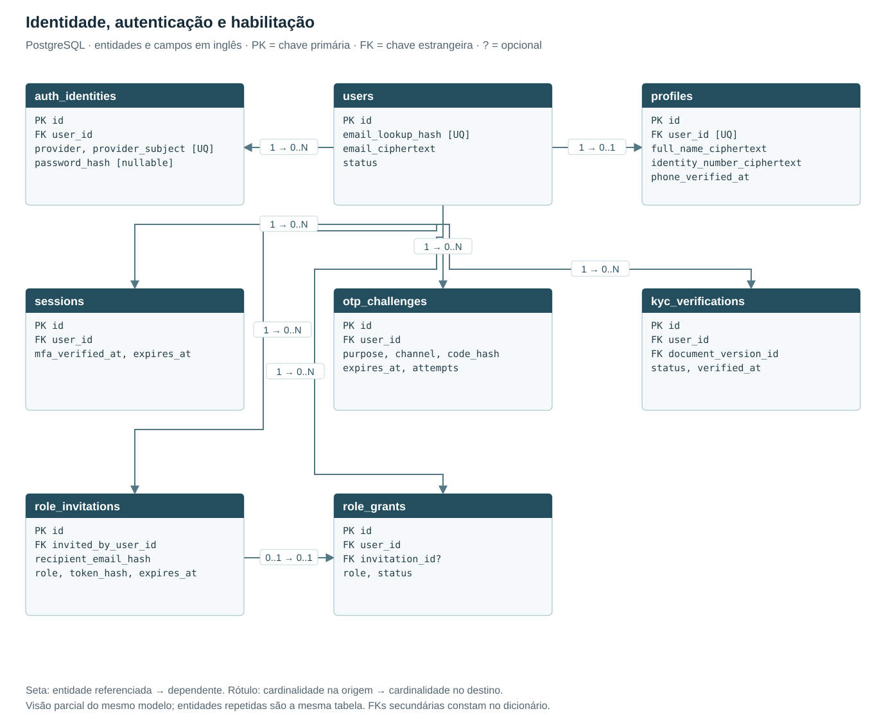

Uma conta pessoal pode acumular papéis e representar empresas. KYC pertence ao usuário, nunca à empresa. profiles é opcional enquanto o cadastro está incompleto e obrigatório para habilitação. auth_identities permite vínculo local e Google sem duplicar a conta; password_hash só existe para identidade local. O bootstrap do primeiro administrador é a exceção auditada ao convite em role_grants.

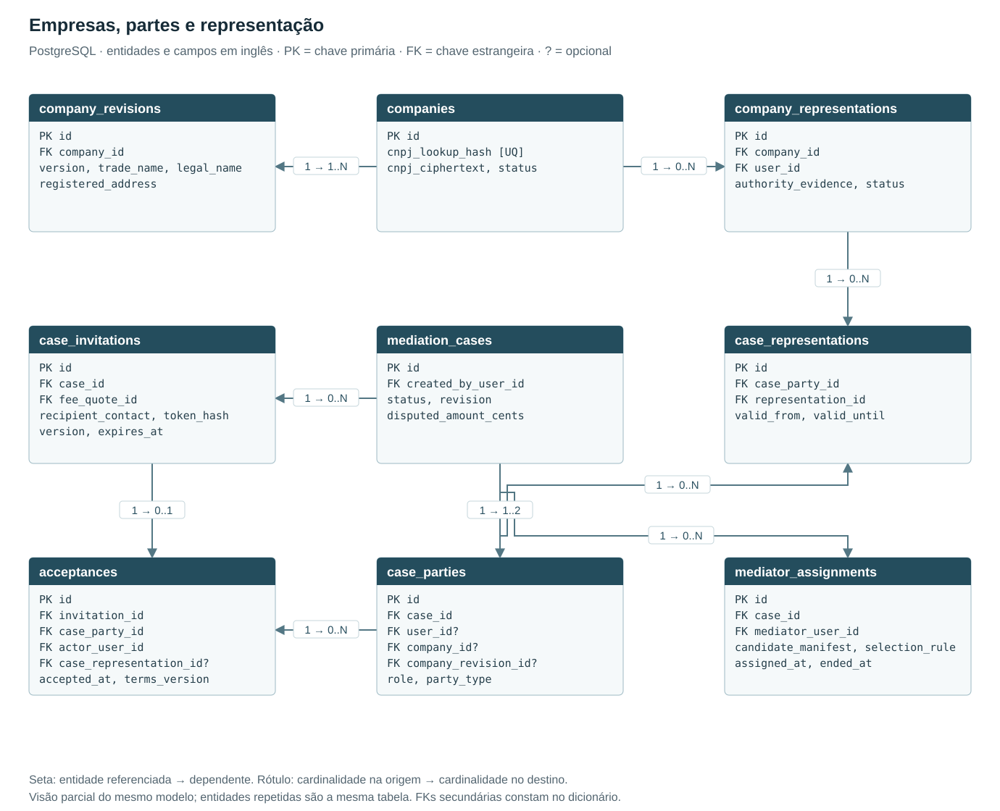

O caso em preparação tem uma ou duas partes identificadas. O convite pode existir antes do cadastro do requerido; não criar usuário fictício para preencher a relação. Ao congelar, o caso precisa de exatamente duas partes, claimant e respondent. Uma parte individual aponta para users; uma parte empresarial aponta para companies e para a revisão cadastral aceita. case_representations registra o vínculo autorizado que atua em nome da empresa.

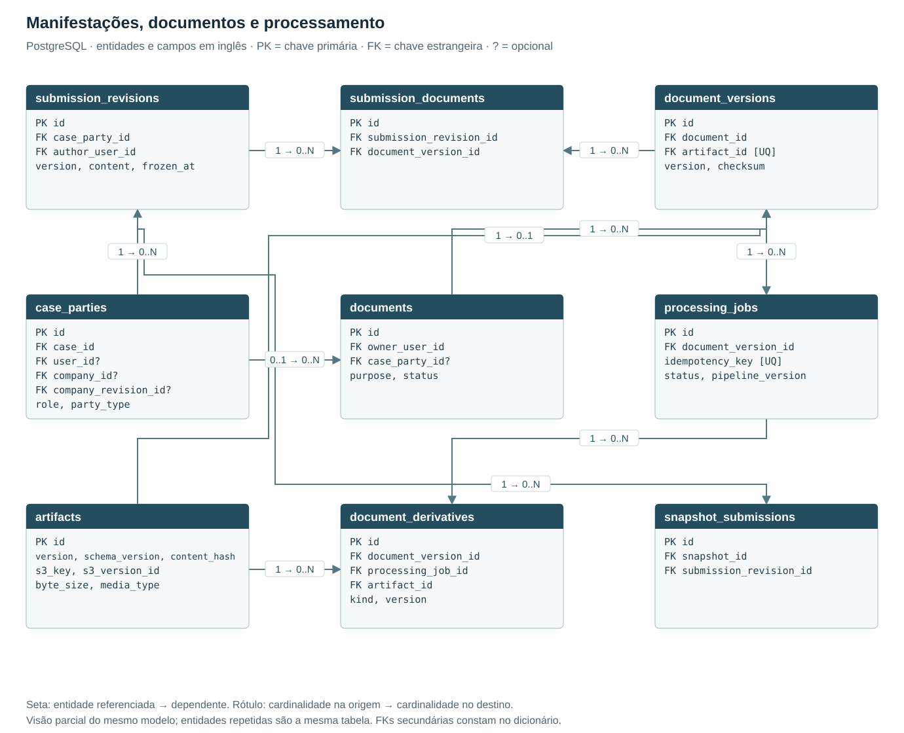

submission_documents resolve a relação N:N entre versões de manifestações e versões de documentos. Um arquivo reaproveitado em outra versão não é sobrescrito. Documentos de KYC não pertencem a case_parties; sua ligação é feita por kyc_verifications. processing_jobs e document_derivatives preservam a versão de origem e o processamento que produziu cada derivado. artifacts guarda metadados e a referência ao objeto, não expõe o S3.

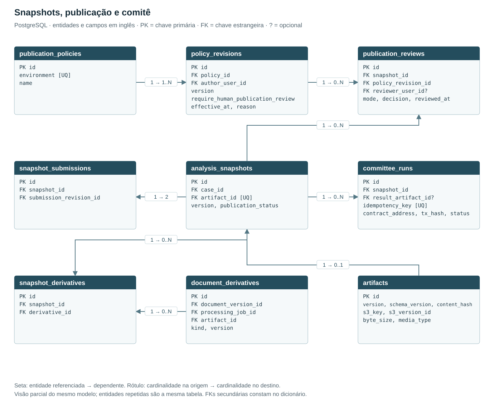

analysis_snapshots congela a entrada de uma análise. snapshot_submissions fixa exatamente uma manifestação de cada parte ao congelar; snapshot_derivatives fixa as versões saneadas usadas. publication_reviews registra a decisão e a versão da política, com revisor obrigatório no modo humano. committee_runs aponta para o snapshot exato e pode registrar rodadas lógicas distintas; a chave de idempotência impede reexecução acidental da mesma rodada.

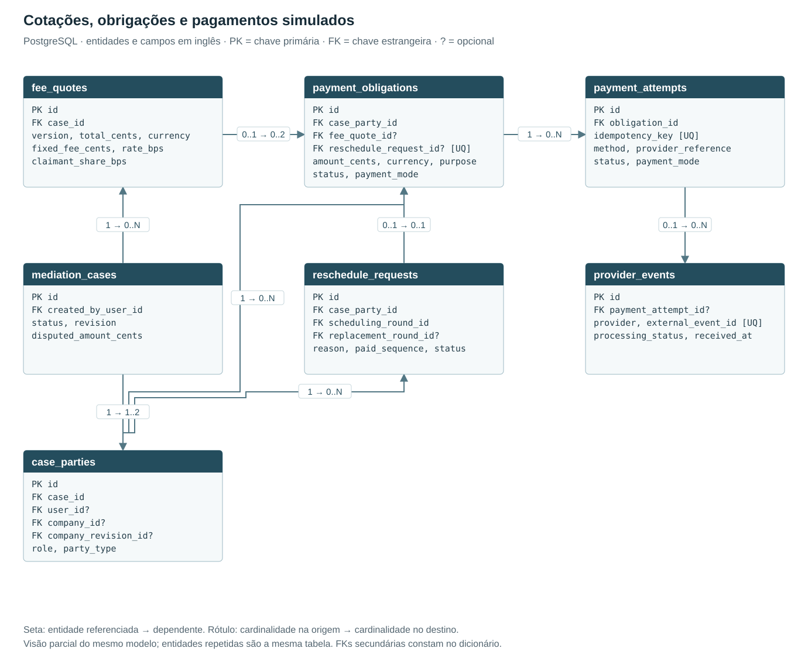

fee_quotes é versionada por caso e aceita junto com o convite. payment_obligations distingue honorários da plataforma de multa de remarcação. Cada obrigação tem um pagador identificado em case_parties, e várias tentativas podem existir sem duplicar a dívida. provider_events aceita vínculo temporariamente ausente para reconciliação de eventos recebidos fora de ordem. Na V1, tentativas e confirmações são exclusivamente simuladas para PIX e cartão.

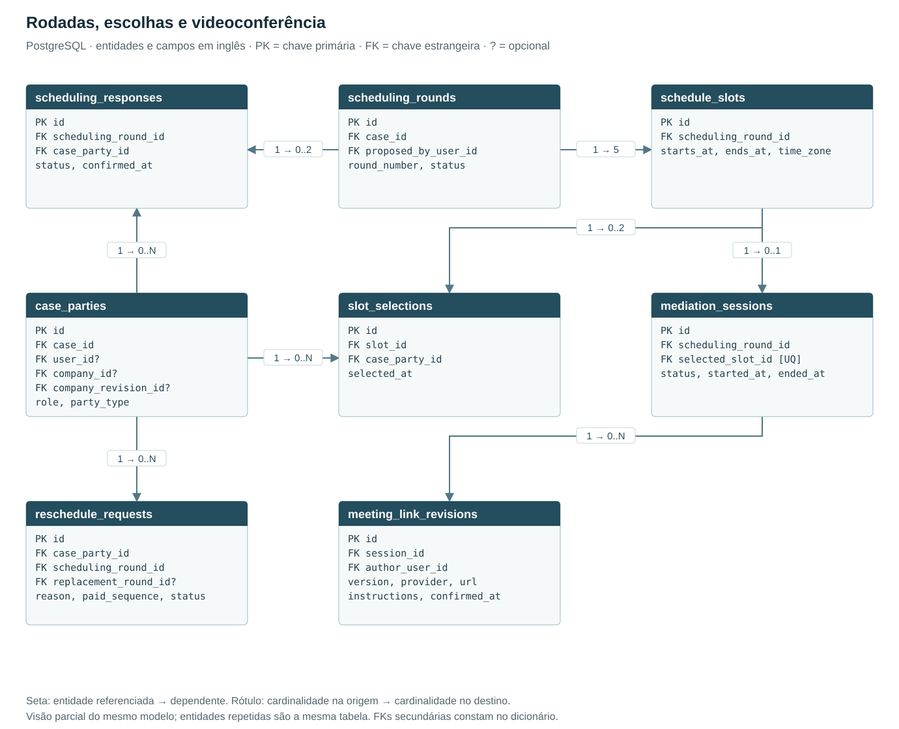

Uma rodada publicada possui exatamente cinco schedule_slots. slot_selections resolve a relação N:N entre as partes e os horários; scheduling_responses separa escolha em rascunho de confirmação. Cada confirmação exige três a cinco escolhas distintas da mesma rodada ou o fluxo alternativo de remarcação. mediation_sessions referencia um horário escolhido por ambas as partes; meeting_link_revisions mantém o histórico do link externo.

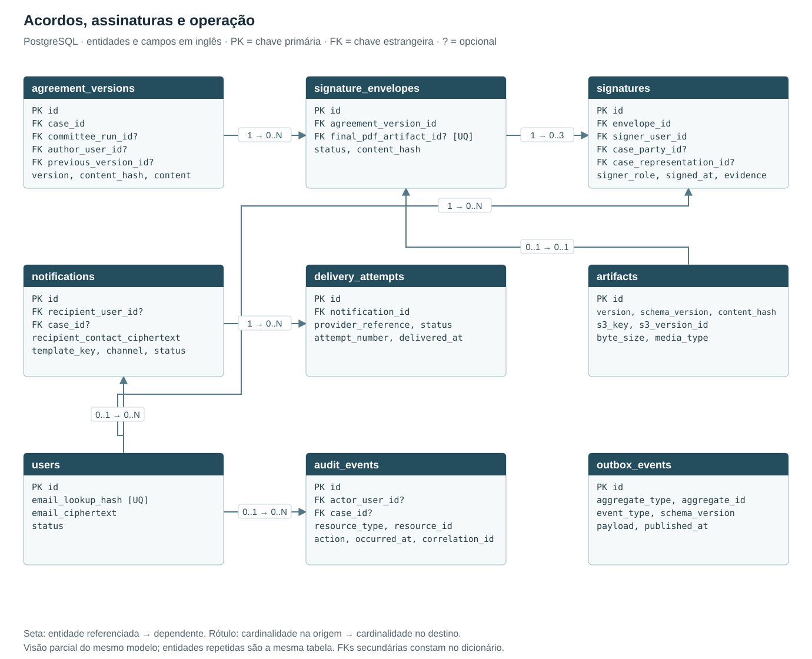

agreement_versions preserva cada versão, incluindo a minuta v1 derivada do comitê. signature_envelopes fixa a versão e o hash a assinar. Um envelope concluído contém as assinaturas das duas partes e do mediador. Quando não há consenso entre as partes, não é exigida a criação de um envelope de acordo. O signatário é sempre users; a empresa figura em case_parties e sua representação em case_representations. AuditEvent e OutboxEvent são registros operacionais distintos; outbox_events usa identificação de agregado lógico, sem FK polimórfica fictícia.

### 19D Integridade, cardinalidades e persistência

RT-47. Implementar as FKs e unicidades do MER em migrations PostgreSQL e as invariantes de múltiplas linhas nos serviços de domínio, com transação e bloqueio ou controle de revisão. CHECKs validam apenas expressões compatíveis com uma linha; contagens, pertencimento ao mesmo caso e mudanças de estado exigem validação transacional. Operações administrativas e jobs obedecem às mesmas regras. Não usar exclusão em cascata para apagar automaticamente documentos, evidências, acordos ou auditoria que precisem de retenção.

| Grupo | Regra de implementação |
| --- | --- |
| Identidade e credenciais | users.email_lookup_hash único; profiles.user_id único; auth_identities com UNIQUE(provider, provider_subject). Normalização, vínculo Google/local e alteração de identidade seguem as regras de cadastro; nunca armazenar senha em claro. Identificadores cifrados usam índice HMAC separado, não hash simples. |
| Convites de papel | role_grants.invitation_id tem UNIQUE quando preenchido; convite aceito uma única vez. Uma concessão ativa por (user_id, role); o bootstrap é registrado sem convite e não torna convite opcional no fluxo comum. |
| Empresas | companies.cnpj_lookup_hash único; UNIQUE(company_id, version) em company_revisions. Uma representação ativa por (company_id, user_id), com poderes e evidências rastreáveis; mudanças de poderes não apagam vínculos históricos. |
| Parte individual ou empresarial | CHECK exclusivo: party_type = individual exige user_id e proíbe company_id/company_revision_id; party_type = company exige company_id/company_revision_id e proíbe user_id. A revisão deve pertencer à mesma empresa. |
| Partes e representação | UNIQUE(case_id, role), com role em claimant/respondent. Uma ou duas partes no rascunho; exatamente duas antes do congelamento. case_representations deve apontar para vínculo da mesma empresa, usuário habilitado e poderes válidos. Somente uma representação responsável ativa por parte empresarial; substituições preservam histórico. |
| Convite, aceite e preço | acceptances.invitation_id único; token_hash único por tipo de convite. O aceite liga parte, ator, representação e a fee_quote exibida no convite. Mudança de rateio, versão ou identidade empresarial após aceite exige novo aceite antes de congelar; nenhuma troca silenciosa de condições. |
| Versões de manifestações e documentos | UNIQUE(case_party_id, version) em submission_revisions; UNIQUE(document_id, version) em document_versions. submission_documents exige UNIQUE(submission_revision_id, document_version_id) e prova autorizada da mesma parte/caso. Objetos e versões congelados permanecem imutáveis. |
| Processamento e artefatos | processing_jobs.idempotency_key único. document_derivatives.document_version_id deve coincidir com a origem do processing_job. artifacts mantém a chave, versão e hash canônicos; UNIQUE(s3_key, s3_version_id). Campos de infraestrutura não concedem acesso ao conteúdo. |
| Snapshot e publicação | UNIQUE(case_id, version) em analysis_snapshots; pares únicos em snapshot_submissions e snapshot_derivatives. No congelamento, exatamente duas manifestações, uma por parte, e derivados apenas das provas dessas versões. Snapshot publica somente o JSON saneado; o manifesto privado e suas FKs não integram automaticamente a resposta pública. |
| Política e consenso | UNIQUE(policy_id, version) em policy_revisions, com uma política por ambiente e revisão vigente resolvida transacionalmente. publication_reviews sempre referencia a revisão aplicada; no modo human, reviewer_user_id é obrigatório. committee_runs.idempotency_key único; status publicado é validado no PostgreSQL antes de servir o JSON. |
| Honorários e remarcação | fee_quotes com UNIQUE(case_id, version). payment_obligations tem exatamente uma origem: fee_quote_id para honorários ou reschedule_request_id para multa. Valores são inteiros não negativos em centavos; percentuais são inteiros em basis points (10.000 = 100%). Uma cota por pagador/cotação; soma das cotas igual ao total. Cota de 0% não exige checkout nem bloqueia a análise. |
| Tentativas e eventos | payment_attempts.idempotency_key único; provider_events com UNIQUE(provider, external_event_id), ambos em conjunto. Obrigações, tentativas e eventos preservam o modo simulated/live; eventos simulados nunca liquidam obrigações reais. Uma tentativa de pagamento pertence a uma obrigação; eventos repetidos não duplicam confirmação. |
| Rodadas e escolhas | UNIQUE(case_id, round_number), UNIQUE(scheduling_round_id, case_party_id) nas respostas e UNIQUE(slot_id, case_party_id) nas escolhas. Exatamente cinco horários futuros distintos ao publicar a rodada; ends_at > starts_at. Confirmar resposta exige três a cinco escolhas da mesma rodada e de uma parte do mesmo caso. |
| Sessão e remarcação | Uma sessão por rodada, UNIQUE(scheduling_round_id), além de selected_slot_id único. O horário pertence à rodada e à interseção das escolhas; reserva e confirmação são atômicas. Uma solicitação ativa por parte/rodada; contador pago incrementa uma vez após confirmação. replacement_round_id deve ser do mesmo caso. |
| Termos e assinaturas | UNIQUE(case_id, version) em agreement_versions; previous_version_id e committee_run_id devem pertencer ao mesmo caso. Ao abrir envelope, congelar conteúdo/hash. Cada envelope admite duas assinaturas de partes distintas e uma do mediador; UNIQUE(envelope_id, case_party_id) para as partes e unicidade parcial do mediador. signer_user_id coincide com a parte individual ou com o representante empresarial vigente no ato. Evidências preservam essa condição após eventual troca de representante. |
| Link, atribuição e auditoria | UNIQUE(session_id, version) em meeting_link_revisions; autor deve ser o mediador ativo do caso. Uma atribuição de mediador ativa por caso, com sorteio/elegíveis preservados. Auditoria e outbox guardam actor/correlation_id quando aplicáveis, e nenhum dado sigiloso desnecessário. resource_id e aggregate_id são referências lógicas, sem promessa de FK para múltiplas tabelas. |

No congelamento, registrar também a qualificação privada das partes, a revisão empresarial e a evidência da representação utilizadas no aceite; alterações cadastrais posteriores não reescrevem a identidade histórica da mediação. No ato da assinatura, validar poderes vigentes e preservar o signatário real e sua qualificação nas evidências do envelope. Os cadastros atuais continuam usados somente para operações que exigem dados atuais, como contato e nova autorização.

A implementação deve acrescentar campos operacionais exigidos pelas demais seções — por exemplo, proveniência de IA, controle de concorrência, verificação de telefone e retenção. O dicionário abaixo apresenta campos principais, não uma lista exaustiva de colunas. Texto estruturado privado pode usar JSONB no PostgreSQL quando exigir transação; conteúdo documental canônico e PDFs permanecem no S3 privado. As referências a users e a entidades empresariais nunca são copiadas automaticamente para o JSON público.

No DynamoDB, artifacts é uma projeção de artefatos, não uma tabela relacional com FKs: PK = ARTIFACT#{artifact_id} e SK = VERSION#{version}. version identifica a versão imutável declarada pelo artefato e não é alterado após persistência. O artifact_id é a chave de artifacts no PostgreSQL; o UUID público continua sendo analysis_snapshots.id. A API resolve snapshot → artifact no PostgreSQL, valida publicação e serve os bytes canônicos. Não há FK ou transação distribuída entre PostgreSQL, DynamoDB e S3; a consistência segue 19B. Um snapshot retirado continua inacessível mesmo que a projeção ainda exista.

### 19E Dicionário de entidades proposto

Os destinos indicados por → referenciam a PK id da tabela nomeada. UQ junto a um campo significa unicidade individual; quando aparece após dois campos na mesma expressão, indica chave composta, conforme 19D. Além das unicidades indicadas nos campos, aplicar as constraints de domínio em 19D. Todos os nomes de implementação abaixo estão em inglês; as descrições editoriais permanecem em português.

| Tabela proposta | Campos principais e referências |
| --- | --- |
| users | PK id; email_lookup_hash [UQ]; email_ciphertext; status |
| profiles | PK id; FK user_id [UQ] -> users; full_name_ciphertext; identity_number_ciphertext; phone_verified_at |
| auth_identities | PK id; FK user_id -> users; provider, provider_subject [UQ]; password_hash [nullable] |
| kyc_verifications | PK id; FK user_id -> users; FK document_version_id -> document_versions; status, verified_at |
| sessions | PK id; FK user_id -> users; mfa_verified_at, expires_at |
| otp_challenges | PK id; FK user_id -> users; purpose, channel, code_hash; expires_at, attempts |
| role_invitations | PK id; FK invited_by_user_id -> users; recipient_email_hash; role, token_hash, expires_at |
| role_grants | PK id; FK user_id -> users; FK invitation_id? -> role_invitations; role, status |
| companies | PK id; cnpj_lookup_hash [UQ]; cnpj_ciphertext, status |
| company_revisions | PK id; FK company_id -> companies; version, trade_name, legal_name; registered_address |
| company_representations | PK id; FK company_id -> companies; FK user_id -> users; authority_evidence, status |
| mediation_cases | PK id; FK created_by_user_id -> users; status, revision; disputed_amount_cents |
| case_parties | PK id; FK case_id -> mediation_cases; FK user_id? -> users; FK company_id? -> companies; FK company_revision_id? -> company_revisions; role, party_type |
| case_representations | PK id; FK case_party_id -> case_parties; FK representation_id -> company_representations; valid_from, valid_until |
| case_invitations | PK id; FK case_id -> mediation_cases; FK fee_quote_id -> fee_quotes; recipient_contact, token_hash; version, expires_at |
| acceptances | PK id; FK invitation_id -> case_invitations; FK case_party_id -> case_parties; FK actor_user_id -> users; FK case_representation_id? -> case_representations; accepted_at, terms_version |
| mediator_assignments | PK id; FK case_id -> mediation_cases; FK mediator_user_id -> users; candidate_manifest, selection_rule; assigned_at, ended_at |
| submission_revisions | PK id; FK case_party_id -> case_parties; FK author_user_id -> users; version, content, frozen_at |
| documents | PK id; FK owner_user_id -> users; FK case_party_id? -> case_parties; purpose, status |
| document_versions | PK id; FK document_id -> documents; FK artifact_id [UQ] -> artifacts; version, checksum |
| submission_documents | PK id; FK submission_revision_id -> submission_revisions; FK document_version_id -> document_versions |
| processing_jobs | PK id; FK document_version_id -> document_versions; idempotency_key [UQ]; status, pipeline_version |
| document_derivatives | PK id; FK document_version_id -> document_versions; FK processing_job_id -> processing_jobs; FK artifact_id -> artifacts; kind, version |
| artifacts | PK id; version, schema_version, content_hash; s3_key, s3_version_id; byte_size, media_type |
| analysis_snapshots | PK id; FK case_id -> mediation_cases; FK artifact_id [UQ] -> artifacts; version, publication_status |
| snapshot_submissions | PK id; FK snapshot_id -> analysis_snapshots; FK submission_revision_id -> submission_revisions |
| snapshot_derivatives | PK id; FK snapshot_id -> analysis_snapshots; FK derivative_id -> document_derivatives |
| publication_policies | PK id; environment [UQ]; name |
| policy_revisions | PK id; FK policy_id -> publication_policies; FK author_user_id -> users; version; require_human_publication_review; effective_at, reason |
| publication_reviews | PK id; FK snapshot_id -> analysis_snapshots; FK policy_revision_id -> policy_revisions; FK reviewer_user_id? -> users; mode, decision, reviewed_at |
| committee_runs | PK id; FK snapshot_id -> analysis_snapshots; FK result_artifact_id? -> artifacts; idempotency_key [UQ]; contract_address, tx_hash, status |
| fee_quotes | PK id; FK case_id -> mediation_cases; version, total_cents, currency; fixed_fee_cents, rate_bps; claimant_share_bps |
| payment_obligations | PK id; FK case_party_id -> case_parties; FK fee_quote_id? -> fee_quotes; FK reschedule_request_id? [UQ] -> reschedule_requests; amount_cents, currency, purpose; status, payment_mode |
| payment_attempts | PK id; FK obligation_id -> payment_obligations; idempotency_key [UQ]; method, provider_reference; status, payment_mode |
| provider_events | PK id; FK payment_attempt_id? -> payment_attempts; provider, external_event_id [UQ]; processing_status, received_at |
| reschedule_requests | PK id; FK case_party_id -> case_parties; FK scheduling_round_id -> scheduling_rounds; FK replacement_round_id? -> scheduling_rounds; reason, paid_sequence, status |
| scheduling_rounds | PK id; FK case_id -> mediation_cases; FK proposed_by_user_id -> users; round_number, status |
| schedule_slots | PK id; FK scheduling_round_id -> scheduling_rounds; starts_at, ends_at, time_zone |
| slot_selections | PK id; FK slot_id -> schedule_slots; FK case_party_id -> case_parties; selected_at |
| scheduling_responses | PK id; FK scheduling_round_id -> scheduling_rounds; FK case_party_id -> case_parties; status, confirmed_at |
| mediation_sessions | PK id; FK scheduling_round_id -> scheduling_rounds; FK selected_slot_id [UQ] -> schedule_slots; status, started_at, ended_at |
| meeting_link_revisions | PK id; FK session_id -> mediation_sessions; FK author_user_id -> users; version, provider, url; instructions, confirmed_at |
| agreement_versions | PK id; FK case_id -> mediation_cases; FK committee_run_id? -> committee_runs; FK author_user_id? -> users; FK previous_version_id? -> agreement_versions; version, content_hash, content |
| signature_envelopes | PK id; FK agreement_version_id -> agreement_versions; FK final_pdf_artifact_id? [UQ] -> artifacts; status, content_hash |
| signatures | PK id; FK envelope_id -> signature_envelopes; FK signer_user_id -> users; FK case_party_id? -> case_parties; FK case_representation_id? -> case_representations; signer_role, signed_at, evidence |
| notifications | PK id; FK recipient_user_id? -> users; FK case_id? -> mediation_cases; recipient_contact_ciphertext; template_key, channel, status |
| delivery_attempts | PK id; FK notification_id -> notifications; provider_reference, status; attempt_number, delivered_at |
| audit_events | PK id; FK actor_user_id? -> users; FK case_id? -> mediation_cases; resource_type, resource_id; action, occurred_at, correlation_id |
| outbox_events | PK id; aggregate_type, aggregate_id; event_type, schema_version; payload, published_at |

## 20 Contratos de API propostos

Prefixo privado /api/v1. Endpoints abaixo são um contrato inicial de escopo, a detalhar em OpenAPI antes da implementação. Retornos assíncronos usam 202 com job_id; criação usa 201; conflitos de revisão usam 409; acesso negado usa 403 ou 404 conforme política contra enumeração. Erros incluem código estável, mensagem e correlation_id. Criação e adesão de casos aceitam party_type e company_id quando aplicável; actor_user_id é obtido da sessão, nunca confiado ao corpo da requisição. O backend resolve e valida o vínculo antes de registrar qualquer ação em nome da empresa.

| Grupo | Operações principais | Controle específico |
| --- | --- | --- |
| Auth | POST /auth/register, /login, /google, /logout | Rate limit e validação do provedor |
| Recuperação e fator | POST /auth/password-reset, /auth/mfa/challenges, /auth/mfa/verify | Uso único e sessão limitada |
| Perfil e KYC | GET/PATCH /me; POST /kyc/documents, /kyc/submit, /me/phone/verify | Conta pessoal e KYC exclusivo da pessoa física |
| Empresas | POST /companies; GET/PATCH /companies/{id}; GET /me/companies | Campos empresariais, revisão, vínculo ativo e CNPJ único |
| Representação | POST /companies/{id}/representation-requests; GET /cases/{id}/representations; POST /cases/{id}/representative-changes | Concessão controlada, poderes registrados, KYC pessoal e auditoria |
| Casos | POST /cases; GET /cases/{id}; PATCH /cases/{id}/draft | Papel, vínculo e revisão |
| Convites | POST /cases/{id}/invitations; POST /invitations/{token}/accept | Token não é acesso aos documentos |
| Manifestações | POST /cases/{id}/submissions e /imports | Autoria e sanitização |
| Documentos | POST /uploads/intents; PUT /uploads/{id}/content; POST /uploads/{id}/complete | Bytes enviados à API autenticada; backend valida checksum/versão e acessa S3 internamente |
| Provas | DELETE /cases/{id}/documents/{doc}; GET /documents/{id}/content | Editabilidade e streaming privado |
| Congelamento | POST /cases/{id}/freeze | Revisão esperada e transação |
| Pagamentos | GET /cases/{id}/payments; POST /payments/{id}/checkout | Somente a cota do pagador |
| Progresso | GET /jobs/{id}; GET /cases/{id}/timeline | Somente dados visíveis ao papel |
| Mediador | GET /mediator/cases; POST /cases/{id}/agreement-versions | Atribuição e liberação |
| Agenda | POST /cases/{id}/rounds, /rounds/{id}/selections | Cinco opções; confirmação exige seleção de três a cinco opções distintas |
| Videoconferência | GET /cases/{id}/session; PATCH /cases/{id}/session/meeting-link | Leitura pelos participantes autorizados; edição pelo mediador atribuído, com revisão e auditoria |
| Remarcação | POST /cases/{id}/reschedules | Rodada, contador e pagamento |
| Assinatura | POST /cases/{id}/signature-envelopes | Versão final congelada |
| Administração | POST /admin/invitations; POST /admin/cases/{id}/reassign | Papel, motivo e auditoria |
| Política de publicação | GET/PATCH /admin/publication-policy | Administrador, reautenticação, motivo, revisão esperada e auditoria |
| Webhooks | POST /webhooks/{provider} | Autenticação e deduplicação |
| Público | GET /public/v1/cases/{snapshot_uuid}.json | Sem login; JSON canônico saneado e publicado no corpo da resposta, sem redirecionamento ao armazenamento |

Webhooks não dependem da sessão de navegador. Verificar assinatura criptográfica quando o fornecedor a oferecer, timestamp e replay; caso contrário, combinar credencial de callback e reconciliação autenticada conforme capacidade real do serviço. Nunca aceitar um evento financeiro ou de assinatura apenas por conter o ID correto.

## 21 Segurança, privacidade e requisitos operacionais

RT-20. Inventariar dados e finalidades: cadastro, KYC, provas, comunicação, cobrança, análise e assinatura. Definir controlador, operadores, bases legais, avisos de privacidade, contratos e transferências internacionais. Consentimentos e ciência de termos, quando aplicáveis, guardam versão, data e contexto. Não usar autorização genérica como substituto da análise de finalidade.

RT-21. Retenção será definida por categoria e etapa: cadastros incompletos, KYC, convites, provas, acordos, auditoria e backups. Prever bloqueio de exclusão por obrigação de preservação, correção, exportação e eliminação verificável quando cabível. Proposta operacional: uploads órfãos expiram em 24 horas; prazos de documentos de casos exigem decisão jurídica e comercial. Não definir retenção ilimitada por padrão.

RT-22. Implementar TLS, criptografia em repouso, prevenção de XSS/CSRF, limites de upload e requisições, defesa contra enumeração e autorização por objeto. Scanner e renderizador de documentos executam com recursos limitados. O frontend exibe estados de erro sem expor detalhes internos ou dados de terceiros.

RT-23. Auditoria registra acesso a originais, alterações de papel, correções de identidade, publicação, alteração de preço, transições e operações de assinatura. Separar os eventos de domínio do log técnico. Evitar copiar conteúdo sigiloso para a trilha. Proteger o destino de auditoria contra alterações pela credencial ordinária da aplicação.

| Indicador | Meta proposta para piloto | Como verificar |
| --- | --- | --- |
| Disponibilidade da API | 99,5% mensal | Monitoramento externo de operações essenciais |
| Latência da API | p95 menor que 500 ms sem tarefas externas | Teste com carga definida |
| Carga inicial | 50 usuários simultâneos e 100 casos por mês | Ensaio e observação do piloto |
| Recuperação do banco | RPO até 24 h; RTO até 8 h | Restauração real em ambiente isolado |
| Processamento assíncrono | Progresso consultável e falhas explicadas | Testes de interrupção e retomada |
| Acessibilidade | Teclado, leitor de tela e contraste; referência WCAG AA | Auditoria dos fluxos principais |

As metas de disponibilidade, carga e recuperação referem-se ao ambiente implantado na fase 2; o modo local não promete disponibilidade de produção. As metas apresentadas são premissas iniciais de dimensionamento, sujeitas à validação de capacidade e operação. Para operação comercial com maior exigência, propor 99,9%, RPO de quinze minutos e RTO de quatro horas, com PITR, redundância e ensaio de recuperação antes de assumir o compromisso. Tempo de OCR, IA e consenso será medido; não prometer conclusão em minutos para todo caso.

## 22 Requisitos de validação jurídica

O sistema deve apresentar IA e mediador como apoio à composição consensual, sem atribuir a eles poder de impor um acordo. A Lei de Mediação preserva voluntariedade e confidencialidade; a escolha/aceitação do mediador, impedimentos e assistência por advogado afetam o fluxo. Se uma parte comparecer assistida, a situação da outra deve ser tratada conforme a regra legal aplicável. [F1]

O convite do produto precisa ser compatibilizado com os elementos e prazos dos arts. 21 e 22, incluindo escopo, primeira reunião e efeitos da ausência de resposta. O convite preliminar digital e o convite formal podem ser etapas distintas, mas essa distinção exige definição jurídica. Não anunciar que o fluxo atual já satisfaz esses dispositivos. [F1]

Pessoas físicas e empresas estão incluídas na primeira entrega por decisão de produto. A empresa possui cadastro próprio e é parte no procedimento; somente seu representante realiza KYC. A conferência de poderes para atuar e assinar é uma verificação de representação separada, cujo procedimento e evidências serão definidos em D-18; ela não corresponde a KYC empresarial. Menores, incapazes, matérias especiais e direitos que exigem homologação precisam de triagem e encaminhamento próprios. A elegibilidade não deve ser decidida autonomamente por uma LLM.

Antes de produção, validar o regulamento de mediação, tratamento das provas compartilhadas, publicação/transferência a terceiros, retenção, honorários, remarcações, reembolsos e assinatura. Essas são dependências da definição do serviço, não afirmações de que qualquer configuração técnica assegura conformidade.

## 23 Critérios de aceite e homologação

| ID | Cenário | Resultado esperado |
| --- | --- | --- |
| CA-03 | Cadastro local e Google | Contas vinculadas corretamente; nenhum segredo em claro |
| CA-04 | KYC incompleto ou código errado | Abertura/instrução bloqueada; erro recuperável |
| CA-05 | Login de conta habilitada | APIs privadas bloqueadas até segundo fator válido |
| CA-06 | Troca de telefone | Novo número só usado após verificação |
| CA-07 | Upload múltiplo com uma falha | Itens válidos preservados e retry individual |
| CA-08 | PDF malicioso ou tentativa de reutilizar intenção de upload concluída | Sem execução; API não sobrescreve original conferido e não emite URL S3 |
| CA-09 | Dado identificável em resumo | Publicação bloqueada e revisão solicitada |
| CA-10 | Convite aberto por pessoa errada | Sem acesso a provas e sem vínculo automático |
| CA-11 | Pedido alterado após aceite | Nova revisão exige reconfirmação |
| CA-12 | Edição concorrente ao congelamento | Uma revisão consistente; conflito explícito |
| CA-13 | Disputa de R$50 mil e rateio 70/30 | Total R$1.500; cotas R$1.050 e R$450 |
| CA-14 | Rateio 100/0 | Uma obrigação simulada na V1; análise liberada após confirmação |
| CA-15 | Webhook duplicado ou fora de ordem | Ausência de crédito duplicado e de análise repetida |
| CA-16 | Reinício após envio on-chain | Recupera a transação e o snapshot corretos |
| CA-17 | Falta de consenso ou retorno inválido | Suspensão explicada; sem termo aprovado fictício |
| CA-18 | Mediador salva duas edições | v1 preservada e versões posteriores recuperáveis |
| CA-19 | Cada parte confirma três, quatro ou cinco opções entre as mesmas cinco | Seleções aceitas e interseção calculada corretamente; ao menos uma opção comum |
| CA-20 | Segunda remarcação paga da mesma parte | Multa de R$198; contador da outra parte não muda; pagamento simulado na V1 |
| CA-21 | Alteração durante assinaturas | Envelope anterior invalidado; novos aceites |
| CA-22 | Três assinaturas completas | PDF final privado e evidências disponíveis |
| CA-23 | Acesso cruzado entre casos | API, arquivo e listagens recusam a exposição |
| CA-24 | Perda simulada do banco | Restauração recupera vínculos, versões e pagamentos |
| CA-25 | PIX/cartão na V1 | Aviso de simulação e ausência de dados financeiros reais |
| CA-26 | Aprovação, recusa e expiração simuladas | Backend preserva estados e idempotência |
| CA-27 | Evento simulado em caso live | Nenhuma liquidação nem liberação do caso |
| CA-28 | Worker interrompido durante OCR/IA | Nova tentativa sem perda nem efeito duplicado |
| CA-29 | Duas réplicas recebem o mesmo evento | Uma conclusão lógica e vínculos coerentes |
| CA-30 | JSON acima do limite inline | Payload no S3, referência e hash íntegros |
| CA-31 | Falha entre S3, DynamoDB e PostgreSQL | Sem liberação prematura; retomada consistente |
| CA-32 | Projeção antiga após retirada | Endpoint público nega acesso |
| CA-33 | Fase 2 — Terraform em homologação | Plan revisado, implantação reproduzível e segundo plan sem drift esperado |
| CA-34 | Fase 3 — API e workers em Kubernetes | Probes, encerramento, IAM e processamento validados antes da migração; não bloqueia as fases 1 e 2 |
| CA-35 | Fase 3 — troca ECS para EKS | Mesmos dados preservados, sem recriar RDS, tabelas ou buckets; não integra a homologação das fases 1 e 2 |
| CA-36 | Seleção de Empresa no cadastro | Formulário adicional com nome fantasia, razão social, CNPJ e endereço; dados pessoais preservados |
| CA-37 | Representante com KYC pendente e empresa cadastrada | Atuação no caso bloqueada até habilitação pessoal; nenhuma etapa de KYC exigida da empresa |
| CA-38 | Convite e comunicações de uma parte empresarial | Empresa identificada como parte; envio ao canal autorizado e ator humano registrado |
| CA-39 | Acordo entre pessoa física e empresa, ou entre duas empresas | Dados empresariais no termo e assinatura pessoal do representante em nome da empresa |
| CA-40 | Usuário informa CNPJ já cadastrado sem vínculo | Não obtém acesso a cadastro privado, documentos ou casos; vinculação segue fluxo controlado |
| CA-41 | Atualização empresarial ou substituição de representante | Histórico preservado, autorização reavaliada e envelope pendente substituído quando necessário |
| CA-42 | Publicação de snapshot com parte empresarial | Razão social, nome fantasia, CNPJ e referências identificáveis do representante não aparecem no JSON liberado |
| CA-43 | PDF com texto e página ou evidência visual sem texto | Rota por página identifica a lacuna; evidência não é descartada e cobertura é verificada |
| CA-44 | Falta de rota externa autorizada ou falha de IA | Job pendente/recuperável; sem envio alternativo indevido e sem resumo aprovado fictício |
| CA-45 | Resposta JSON válida com valor incorreto ou trecho sem fonte | Validação factual aponta divergência e impede liberação até resolução |
| CA-46 | Documento extenso com resposta truncada ou página ausente | Incompletude detectada; retomada por unidade e consolidação somente com cobertura confirmada |
| CA-47 | Piloto com configuração inicial ou exigência religada | Publicação nova bloqueada até revisão humana válida da versão; política indisponível também bloqueia |
| CA-48 | Administrador desliga a exigência de revisão humana | Itens podem ser liberados após validações; decisão registra modo automático, política e alteração auditada |
| CA-49 | Política muda enquanto worker prepara a publicação | Backend revalida a política atual; trabalhos pendentes seguem a nova regra e histórico publicado é preservado |
| CA-50 | Usuário não administrador tenta mudar a política | Requisição negada; flag enviada pelo cliente não altera a exigência aplicada no servidor |
| CA-51 | Parte tenta confirmar zero, uma ou duas opções, ou opções inválidas/repetidas | Confirmação recusada no servidor; permanece disponível solicitar remarcação com multa e justificativa |
| CA-52 | Parte solicita remarcação em vez de selecionar pelo menos três horários | Multa exibida; nova rodada somente após confirmação do pagamento, sem incrementar contador em tentativa falha |
| CA-53 | Horário confirmado antes do cadastro do link | Agendamento preservado; partes veem link pendente e recebem aviso quando o mediador o informar |
| CA-54 | Mediador cadastra ou altera link de Zoom, Meet, Teams ou equivalente | URL vigente disponível na área autenticada; participantes notificados; horário e multa inalterados |
| CA-55 | Outro usuário tenta alterar ou acessar link sem vínculo | Acesso negado; edição restrita ao mediador atribuído; link ausente de artefatos públicos |
| CA-56 | Sessão remarcada com link de uma rodada anterior | Link requer confirmação ou substituição pelo mediador antes de ser apresentado como vigente |
| CA-57 | Tentativa externa de acesso aos dados | Local: sem portas de dados no host/LAN. AWS: negar operação também com credencial de aplicação fora do endpoint autorizado |
| CA-58 | Consulta pública com UUID publicado | API retorna 200, application/json e bytes canônicos; nenhum redirecionamento ou endereço do armazenamento |
| CA-59 | Consulta com UUID desconhecido, privado ou retirado | API retorna 404 sem conteúdo privado; nenhuma listagem pública |
| CA-60 | Upload e download pelo navegador | Transferência exclusivamente por API autenticada; nenhum acesso direto ao S3 ou credencial AWS entregue ao cliente |
| CA-61 | Fases 1 e 2 sem Kubernetes | Local em Compose; AWS em ECS Fargate/Terraform. Nenhum cluster EKS/Kubernetes, Helm ou KEDA exigido nessas fases |
| CA-62 | Revisão de código, migrations, schema JSON e Terraform | Identificadores, comentários, docstrings, enums e mensagens técnicas em inglês; conteúdo real e apresentação localizada preservados |
| CA-63 | Persistência de parte empresarial, manifestações e snapshot | FKs e versões do mesmo caso; mistura PF/PJ, representação de outra empresa ou prova de outra parte rejeitadas; manifesto congelado preservado |
| CA-64 | Homologação do modelo relacional | Unicidades e transações impedem aceite duplicado, pagamento em duplicidade, confirmação com menos de três escolhas, sessão fora da interseção e assinatura de versão divergente |
| CA-65 | Fase 1 — bootstrap em máquina preparada | Compose inicia PostgreSQL, LocalStack e aplicação; healthchecks, recursos e migrations válidos; nenhuma infraestrutura AWS real provisionada |
| CA-66 | Reinício dos serviços locais | Caso, arquivos, JSONs e mensagens preservados; worker retoma sem efeito duplicado nem perda de referências |
| CA-67 | Clientes de infraestrutura local | S3/DynamoDB/SQS usam apenas LocalStack; falha de endpoint não redireciona ao AWS real; PostgreSQL e LocalStack sem portas públicas |
| CA-68 | Fase 1 com integrações reais | Login Google, chamada OpenRouter e consenso GenLayer real testados; validadores leem somente o snapshot aprovado via HTTPS restrito, sem acesso aos dados privados |
| CA-69 | Configuração de produção contém simulador indevido | Startup rejeita simulação de identidade/comitê/assinatura; pagamento simulado só é permitido na modalidade V1 explícita |
| CA-70 | Passagem local → AWS | Contratos, políticas e falhas homologados em serviços reais; dados locais não são promovidos automaticamente nem versionIds copiados como equivalentes |

A validação da fase 1 combina dependências locais, testes isolados e ensaios reais com Google, OpenRouter e GenLayer; ainda não equivale à homologação dos serviços gerenciados AWS. A homologação da fase 2 combina testes automatizados de domínio, contrato e integração com testes manuais de identidade, documentos, acessibilidade, assinatura e revisão por mediador. Usar casos sintéticos nas integrações de teste e verificar que a análise local não seja rotulada como consenso GenLayer.

## 24 Plano de implementação e custos

A fase de infraestrutura atual é a fase 1 local. Implementar primeiro um fluxo completo com dados sintéticos em Docker Compose/LocalStack, mantendo os três provedores reais confirmados. Os incrementos funcionais abaixo não são novas fases de infraestrutura; a numeração das três fases da seção 17 fica preservada.

| Incremento funcional | Entrega na fase 1 local | Condição de conclusão |
| --- | --- | --- |
| A — Fundação | Repositório, CI, Dockerfiles, Compose, bootstrap, API, identidade PF/PJ e adaptadores reais | Ambiente reproduzível sem provisionar AWS, usuário de teste habilitado e representação isolada |
| B — Instrução | Upload, texto, adaptador documental, carta, convite e revisões | Caso sintético das duas partes congelado; chamada real OpenRouter preservada e rastreável |
| C — Simulação e comitê | Cotas PIX/cartão, snapshot, fila e adaptador GenLayer | Pagamento simulado libera consenso GenLayer real de teste, com resultado recuperável |
| D — Mediação humana | Mediadores de teste, termo, agenda e link externo | Agendamento e remarcação rastreáveis pelas mesmas regras de domínio |
| E — Formalização | Fluxo de assinatura simulada, PDF de teste e auditoria | Três signatários de teste, mesmo hash e artefatos recuperáveis |
| F — Consolidação local | Falhas, reinícios, duplicatas, contratos e documentação | Ambiente e integrações reais validados; revisão humana de publicação ligada por padrão |

Fase 2: implementar e aplicar Terraform para AWS, implantar as imagens homologadas no ECS Fargate e substituir dependências locais pelos serviços gerenciados. Homologar integrações reais e controles ausentes nos simuladores antes de uso externo; executar piloto assistido sem cobrança real conforme a V1. A landing page existente permanece até a migração planejada. Não é necessário Kubernetes nessa etapa.

Fase 3: avaliar e executar a migração do runtime para Kubernetes/EKS com Helm, identidades e escalabilidade correspondentes. Preservar serviços de dados, contratos e UUIDs, com plano de retorno. Essa fase não bloqueia a conclusão local ou a implantação em ECS.

A segunda etapa funcional de cobrança real é independente: integrar PSP, webhooks, reconciliação e estornos somente após sua própria homologação e aprovação. “Fase 2 AWS” não significa ativar PIX/cartão reais.

O backend e o frontend podem avançar com OpenAPI e testes isolados, sem depender da otimização contínua do IC. A conclusão integrada da fase 1 inclui Google, OpenRouter e GenLayer reais, com casos sintéticos e controle de custos; mocks ajudam a desenvolver componentes, mas não comprovam essas integrações.

Na fase 1, não há recursos AWS reais provisionados, mas há custos potenciais da licença LocalStack, máquina local, OpenRouter e transações GenLayer, além de outros fornecedores habilitados. Local não significa gratuito ou offline. Na fase 2, mesmo sem cobrar as partes na V1, a plataforma terá custos de infraestrutura e fornecedores. O custo mensal deve ser calculado por: infraestrutura fixa + armazenamento e transferência + OCR/LLM + execução GenLayer + mensagens + pagamento + assinaturas + vídeo + trabalho operacional. Custo por caso deve separar documentos, tokens por etapa, tentativas, chamadas on-chain, número de mensagens e revisões humanas. Honorários recebidos não são margem líquida.

Esta especificação não estabelece uma estimativa financeira definitiva. Volume, tamanho dos arquivos, retenção, região, fornecedores, nível de disponibilidade e equipe ainda precisam ser definidos. Antes de contratar, medir um lote sintético representativo, consultar preços vigentes e estabelecer teto de gasto por caso e por mês, com alerta e interrupção controlada. Não executar chamadas pagas de benchmark sem orçamento autorizado.

## 25 Registro de decisões e dependências

| ID | Decisão necessária | Responsável sugerido | Marco |
| --- | --- | --- | --- |
| D-01 | Resolvida: pessoas físicas e empresas na V1; conta e KYC do representante, empresa nas comunicações e no acordo | Produto — confirmado pelo responsável | Incorporada na revisão 1.3 |
| D-02 | Garantia do KYC, revisão e eventual prova de vida | Produto e segurança | Antes de habilitar usuários reais |
| D-03 | Publicação do JSON, confidencialidade e transferências | Produto e jurídico | Antes de enviar casos reais à rede |
| D-04 | PSP, parcelamento, reembolsos e fiscal | Financeiro e produto | Etapa 2 antes da cobrança real |
| D-05 | Provedor/modalidade de assinatura e evidências | Jurídico e engenharia | Antes do acordo final |
| D-06 | Rede, contrato multi-caso, versão e custos GenLayer | Engenharia do IC | Antes da integração de produção |
| D-07 | Compartilhamento de provas e complementações | Produto e jurídico | Antes da instrução |
| D-08 | Retenção, eliminação e recuperação de identidade | Jurídico e segurança | Antes de coletar dados reais |
| D-09 | Remarcação, teto, isenções e ausência | Produto e jurídico | Antes do agendamento |
| D-10 | Fornecedores de e-mail, SMS e modalidade GREEN-API | Engenharia e operação | Antes da homologação externa |
| D-11 | Prazos de convite, pagamento, resposta e primeira reunião | Produto e jurídico | Antes dos termos de adesão |
| D-12 | Volume, orçamento, disponibilidade e equipe | Responsável pelo projeto | Antes de contratar infraestrutura |
| D-13 | Idiomas das áreas privadas e das minutas | Produto | Antes do frontend autenticado |
| D-14 | Formatos de arquivo, limites e validação do pipeline | Engenharia e mediadores | Antes do piloto documental |
| D-15 | Resolvida: fase 1 local Docker/LocalStack; fase 2 AWS/ECS Fargate; fase 3 Kubernetes | Produto e engenharia | Atualizada na revisão 1.10; AWS não bloqueia desenvolvimento local e Kubernetes não bloqueia as fases 1 e 2 |
| D-16 | Padrões de consulta e benchmark DynamoDB/JSONB | Engenharia | Antes do repositório de artefatos |
| D-17 | Contas AWS, região, DNS, retenção e orçamento | Infraestrutura e responsável pelo projeto | Antes do primeiro Terraform apply |
| D-18 | Procedimento e evidências de poderes de representação; representantes adicionais, substituição e eventual assinatura conjunta | Produto, jurídico e engenharia | Antes de habilitar atuação empresarial real; sem KYC da empresa |
| D-19 | Modelos, provedores, parser/OCR e rotas de privacidade do OpenRouter; limiares de qualidade, limites e orçamento do pipeline | Engenharia, produto e segurança | Antes de processar documentos reais; avaliar corpus autorizado |
| D-20 | Versão/plano LocalStack, persistência e token de CI; conectividade HTTPS restrita para GenLayer | Engenharia e responsável pelo projeto | Antes de homologar a composição integrada da fase 1 |

A decisão confirmada para a V1 é pagamento simulado por PIX ou cartão; cobrança real somente na segunda etapa funcional de pagamentos, independente da fase 2 AWS. A regra financeira adotada para a simulação é a do rascunho: R$500 + 2%. A publicação do site deve ser atualizada para refletir essa fórmula e o momento correto da cobrança, junto com linguagem precisa sobre IA, sigilo, mediador e assinatura. A especificação não promove uma nova versão do IC e não altera seus resultados experimentais. Também está confirmada a inclusão de empresas, com KYC somente do representante, identificação empresarial nas comunicações e assinatura do representante em nome da empresa. D-01 está encerrada; D-18 trata apenas da operacionalização dos poderes de representação.

## 26 Histórico da especificação

Versão 1.0: definição funcional e arquitetura inicial; pagamentos simulados por PIX e cartão na V1.

Versão 1.1: AWS e Terraform desde a fundação; requisitos explícitos para API/workers portáveis a Kubernetes; SQS detalhado; proposta DynamoDB para projeções JSON com S3 canônico e PostgreSQL transacional; plano de migração ECS para EKS e critérios de consistência e recuperação. Os requisitos funcionais e a simulação de pagamentos permanecem vigentes.

Versão 1.2: revisão editorial e publicação em HTML com índice navegável, busca por seção, links permanentes para requisitos e apresentação para impressão. Identificadores, regras de negócio e decisões técnicas da versão 1.1 preservados. A revisão não constitui aprovação das decisões ainda pendentes.

Versão 1.3: inclusão confirmada de pessoas jurídicas na V1. Formulário empresarial, KYC exclusivo do representante, identidade da empresa em convites e comunicações, acordo com qualificação empresarial e assinatura do representante. Modelo de dados, autorização, APIs e critérios de aceite atualizados; D-01 resolvida e D-18 registrada para o procedimento de representação.

Versão 1.4: proposta de processamento híbrido desde a V1. Extração simples no worker Python; leitura complexa, resumo e apoio à anonimização via OpenRouter. Rotas autorizadas, cobertura por página, validação factual, limites e critérios de aceite detalhados; seleção dos modelos e do parser registrada em D-19. Configuração administrativa confirmada para ligar ou desligar a revisão humana de publicação, ligada por padrão no piloto, com política versionada e auditoria.

Versão 1.5: inclusão de diagramas do fluxo principal, estados alternativos e retomada na seção 11, mantendo a tabela de transições. RF-40 ajustado para seleção obrigatória de pelo menos três das cinco opções, aceitando três, quatro ou cinco, ou solicitação de remarcação com multa. RF-42, modelo de dados, API e critérios de aceite alinhados à regra. Diagramas incorporados ao HTML para leitura offline e impressão.

Versão 1.6: RF-44 confirmado como videoconferência externa à escolha do mediador. Link pode ser inserido após o agendamento, com acesso autenticado, avisos de inclusão/alteração e confirmação após remarcação. Modelo de dados, API e critérios de aceite atualizados; integração com fornecedor de vídeo deixa de ser requisito da V1.

Versão 1.7: PostgreSQL, DynamoDB e S3 restritos ao acesso interno. Publicação de processos exclusivamente por API pública que recebe UUID e devolve o JSON aprovado. Uploads e downloads passam pelo backend; eliminada a distribuição de URLs S3. Rede, Terraform, hospedagem do frontend, integrações e critérios de aceite alinhados à restrição.

Versão 1.8: diagrama AWS com ícones oficiais coloridos na seção 17. Piloto definido em ECS Fargate, explicitamente sem Kubernetes/EKS, Helm ou KEDA. Requisitos e critérios EKS classificados como evolução futura; D-15 resolvida e CA-61 adicionado.

Versão 1.9: convenção obrigatória de inglês para código e estruturas técnicas (RT-46); MER lógico em sete visões, com 49 entidades, PKs/FKs, cardinalidades, dicionário e regras de integridade na seção 19 (RT-47). Adicionados CA-62 a CA-64. Mantidos o piloto sem Kubernetes, pagamentos simulados e armazenamento interno.

Versão 1.10: arquitetura em três fases — desenvolvimento local com Docker Compose, PostgreSQL e LocalStack (S3/DynamoDB/SQS); implantação AWS/ECS Fargate; Kubernetes futuro. OpenRouter, Google e consenso GenLayer reais preservados desde a fase 1. Stack local, persistência, testes, contratos e critérios de migração definidos. Novo diagrama local; diagrama AWS identificado como fase 2. RT-48 a RT-55 e CA-65 a CA-70 adicionados; roteiro, Terraform e D-15 alinhados. As decisões de 1.1/1.8 sobre AWS desde o início são substituídas por esta revisão.

## 27 Referências

Fontes consultadas em 29/09/2026. As referências técnicas apoiam escolhas e limitações; os detalhes específicos do produto são propostas desta especificação.

F1. Presidência da República. Lei 13.140 de 2015, especialmente arts. 1, 5, 9, 10, 17, 20, 21, 22 e 30. https://www.planalto.gov.br/ccivil_03/_ato2015-2018/2015/lei/l13140.htm

F2. Presidência da República. LGPD, especialmente definição de anonimização e art. 12. https://www.planalto.gov.br/ccivil_03/_ato2015-2018/2018/lei/l13709compilado.htm

F3. AWS. Download and upload objects with presigned URLs. https://docs.aws.amazon.com/AmazonS3/latest/userguide/using-presigned-url.html

F4. OpenRouter. Provider routing e controles de retenção. https://github.com/OpenRouterTeam/docs/blob/main/guides/routing/provider-selection.mdx e https://openrouter.ai/blog/insights/zero-data-retention/

F5. IETF. RFC 9562, UUIDs, seção UUIDv7. https://www.rfc-editor.org/rfc/rfc9562.html

F6. AWS. Amazon SQS at least once delivery. https://docs.aws.amazon.com/AWSSimpleQueueService/latest/SQSDeveloperGuide/standard-queues-at-least-once-delivery.html

F7. GenLayer. Transactions e protocolo de consenso. https://docs.genlayer.com/understand-genlayer-protocol/core-concepts/transactions

F8. Presidência da República. Código de Processo Civil, arts. 783 e 784. https://www.planalto.gov.br/ccivil_03/_ato2015-2018/2015/lei/l13105compilada.htm

F9. Django e Django REST Framework. https://www.djangoproject.com/ e https://www.django-rest-framework.org/

F10. GREEN-API. SendMessage. https://green-api.com/en/docs/api/sending/SendMessage/

F11. AWS. Limites de itens e objetos grandes no DynamoDB. https://docs.aws.amazon.com/amazondynamodb/latest/developerguide/Constraints.html e https://docs.aws.amazon.com/amazondynamodb/latest/developerguide/bp-use-s3-too.html

F12. AWS. Consistência de leitura e expiração no DynamoDB. https://docs.aws.amazon.com/amazondynamodb/latest/developerguide/HowItWorks.ReadConsistency.html e https://docs.aws.amazon.com/amazondynamodb/latest/developerguide/ttl-expired-items.html

F13. AWS. Identidades de workloads EKS e autoscaling por SQS com KEDA. https://docs.aws.amazon.com/eks/latest/userguide/service-accounts.html e https://docs.aws.amazon.com/prescriptive-guidance/latest/patterns/event-driven-auto-scaling-with-eks-pod-identity-and-keda.html

F14. Kubernetes. Pod lifecycle. https://kubernetes.io/docs/concepts/workloads/pods/pod-lifecycle/

F15. HashiCorp. Terraform S3 backend e locking. https://developer.hashicorp.com/terraform/language/backend/s3

F16. PyMuPDF. Extração de texto e reconhecimento óptico local. https://pymupdf.readthedocs.io/en/latest/recipes-text.html e https://pymupdf.readthedocs.io/en/latest/recipes-ocr.html

F17. OpenRouter. Entrada de PDFs, mecanismos de parsing, limites e cobrança. https://openrouter.ai/docs/guides/overview/multimodal/pdfs

F18. OpenRouter. Saídas estruturadas e compatibilidade por endpoint. https://openrouter.ai/docs/guides/features/structured-outputs

F19. OpenRouter. Controles de retenção zero. https://openrouter.ai/docs/guides/features/zdr

F20. AWS. Restrição de acesso a buckets S3 por endpoint VPC. https://docs.aws.amazon.com/AmazonS3/latest/userguide/example-bucket-policies-vpc-endpoint.html

F21. AWS. Políticas de recurso DynamoDB, incluindo restrição por endpoint VPC. https://docs.aws.amazon.com/amazondynamodb/latest/developerguide/rbac-examples.html

F22. AWS Architecture Icons. Pacote oficial de ícones de 31/07/2026, obtido pela página oficial. https://aws.amazon.com/architecture/icons/

F23. Docker. Redes, isolamento e prontidão em Compose. https://docs.docker.com/compose/how-tos/networking/ e https://docs.docker.com/compose/how-tos/startup-order/

F24. LocalStack. Instalação Docker e serviços S3, DynamoDB e SQS. https://docs.localstack.cloud/aws/getting-started/installation/ e https://docs.localstack.cloud/aws/services/s3/ e https://docs.localstack.cloud/aws/services/dynamodb/ e https://docs.localstack.cloud/aws/services/sqs/

F25. LocalStack. Persistência e configuração da execução local. https://docs.localstack.cloud/aws/developer-tools/snapshots/persistence/ e https://docs.localstack.cloud/aws/customization/configuration-options/

F26. LocalStack. Imagens, autenticação e planos vigentes. https://docs.localstack.cloud/aws/customization/other-installations/docker-images/ e https://www.localstack.cloud/pricing

F27. Mailpit. Imagens Docker para captura local de e-mails. https://mailpit.axllent.org/docs/install/docker/

Referências do projeto: site https://mediarev1.netlify.app/; arquivo index.html fornecido; README.md; ic_v30.py, em especial analyze_case e get_case; studio_cycle.py; docs/TERMO_ACORDO_FORMAL.md. Caminhos relativos de código são relativos ao repositório mediare-dataset. O HTML fornecido está em /Users/cgmello/Documents/Projetos/Mediare/index.html.
